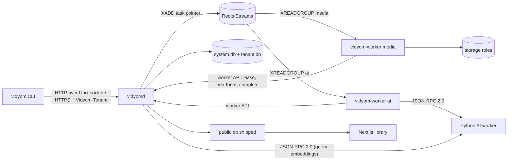

# Vidyom master plan: first executable version

This plan turns `spec/vidyom-specification-v1.2.md` into running code through nine components built in parallel on `main`, plus a final `integration` agent. The spec is the contract. Implementation decisions taken to fill its gaps are in [`docs/decisions.md`](../decisions.md) as `I1, I2, ...`; the maintainer's `Dn` decisions are never relabeled.

Status vocabulary in this file: **target** means what the component must deliver. Nothing here is implemented until its component commits it.

Contents: [1 Scope](#1-what-first-executable-version-means) · [2 Roadmap mapping](#2-how-the-roadmap-phases-are-built) · [3 Runtime model](#3-runtime-model-all-components-must-share) · [4 Components and dependency order](#4-components-and-dependency-order) · [5 Ownership map](#5-ownership-map) · [6 Contract packages](#6-contract-packages) · [7 Contract change rules](#7-rules-for-changing-a-shared-contract) · [8 Parallel-stage rules](#8-rules-for-the-parallel-stage) · [9 Wiring surface](#9-wiring-surface) · [10 Definition of done](#10-definition-of-done-per-component) · [11 Validations left open](#11-validations-left-open)

---

## 1. What "first executable version" means

A person with this repository, Go, Python, Node, FFmpeg, Redis (or Docker) and no cloud accounts can run the whole product on one host and see the full lifecycle work:

> import an original → ingest → search → create a clip through two approval gates → publish to a mock destination → export `public.db` → query the public library → withdraw it.

### 1.1 The demonstrable scenario (`tests/e2e`, `scripts/demo.sh`)

Runs with the `local` storage driver, the `mock` publishing driver, the `fake` AI engine and a mock OpenAI-compatible LLM (each explicitly configured, never a silent fallback; see I9, I12, I27). Every step uses the real binaries over the real API.

| # | Step | Evidence the test asserts | Spec |
|---|---|---|---|
| 1 | Start Redis, then `vidyomd init` (creates `system.db`, tenant `acme`, first admin, one pairing code), start `vidyomd`, `vidyom-worker --pools media`, `vidyom-worker --pools ai` with the Python AI worker | With no master key configured the daemon exits non-zero and opens no listener; with it, `/api/v1/health` answers | D13, §15.6 |
| 2 | `vidyom server add` + `server pair`, `vidyom tenant use acme`, create users `editor@example.com` and `publisher@example.com` and pair them | Requests without `Vidyom-Tenant` are rejected; a device credential works and can be revoked | D12, D32 |
| 3 | Generate a fixture MP4 with FFmpeg, `vidyom original import fixture.mp4 --type yoga_class --title "Hatha Yoga Class" --workflow ingest-original` | Upload is resumable and hash-verified; raw in `archive`, master in `master`, proxy in `proxy`; durations within max(100 ms, 1 frame); ASR audio extracted from the master; status reaches `ready_for_clipping` only after the consolidated condition holds | §3.1, R10, R11, D21, D56 |
| 4 | `vidyom original search "conscious breathing"` | Hits with timestamps from FTS5 and sqlite-vec; asset-scoped filter works | §12.1, D5 |
| 5 | `vidyom clip create --source ORI-001 --prompt "..."` | Job reaches `waiting_approval`, `APR-001` (`clip_selection`) carries excerpt, timestamps, confidence; a CLI that disconnects does not affect the job | §3.2, D51, D53 |
| 6 | Editor runs `vidyom approval approve APR-001 --start .. --end ..` | A viewer is refused. Render reads only from `master` (the `local` driver's access log has no `archive` read). `CLIP-001` exists with lineage to `ORI-001`, its own master, backup and proxy | R13, R27, §3.2 invariant |
| 7 | Publication gate: editor tries `approval approve APR-002` and gets `403`; publisher approves | D7 two-level rule holds | D7, §15.6 |
| 8 | `publish-video` uploads to `mock-main` | `PUB-001` reaches `published` only with a remote ID and URL; retry with the same key makes no second upload | R43, §15.5 |
| 9 | Event `publication.completed` triggers `update-public-library`, which exports and ships `public.db` | The file holds only approved records, with no storage key, ULID or private original data; sensitive segments absent | D18, D30, R44, §15.6 |
| 10 | `curl` the Next.js library search API | The clip is found; the library never contacted `vidyomd` | D34, R44 |
| 11 | `vidyom unpublish CLIP-001 --all`, twice | `publication.withdrawn` emitted, record gone from `public.db`, second run is a no-op | §15.8, D17 |
| 12 | `vidyom security audit --verify` | Hash chain verifies; tampering a row makes it fail | D23 |
| 13 | Resilience: kill `vidyomd` during a transcode; `FLUSHALL` Redis during a queued job | Job resumes from its checkpoint; reconciliation re-enqueues; no node runs twice to completion | §15.5, D4 |

### 1.2 Out of scope for this version

No real call to YouTube, GCS, an LLM vendor or any paid service is made by tests or the demo (I12). Real model accuracy, Litestream with GCS, TPM/KMS unsealing, Vercel hosting and the rest of §17.2 stay **Validate**. Kubernetes, WASM plugins, multi-source clips and externally edited videos stay **Future**. Nothing is pushed, tagged or released.

---

## 2. How the roadmap phases are built

| Phase (§16) | Built by | Real in this version | Skeleton or documented gap |
|---|---|---|---|
| 0 Contracts and prototypes | foundation; `media` (FFmpeg proof) | Schemas, contracts, SQLite driver spike (I1) | MediaCMS, VideoVortex PoCs stay validations (I11) |
| 1 Core and ingestion | `core`, `api`, `engine`, `media`, `cli`, `ai`, `integration` | Daemon, CLI, jobs, SQLite per tenant, Redis, pairing, vault, side-effect classes, `needs_attention`, `ingest-original`, `local` and `gcs` drivers, JSONL logs, Docker Compose | GCS only against a fake server; release process recorded, not executed |
| 2 Semantic clips | `ai`, `engine`, `media`, `core` | Hybrid retrieval, story detection, preview, approvals, render, `create-clip`, `ingest-derived`, versions, disjoint namespaces | Real semantic quality needs real models (Validate) |
| 3 Publishing and public catalog | `publishing`, `library`, `engine` | Mock destination end to end, YouTube connector against an HTTP mock, `publish-video`, `unpublish-video`, `public.db`, Next.js library | Browser OAuth flow for YouTube (I12) |
| 3.1 Rewind | `publishing` | Connector skeleton that declares itself unavailable | Everything else; Rewind's real interface is unvalidated (I11) |
| 4 Plugins, hooks, observability | `extensibility`, `engine`, `publishing` | Stdio plugin runtime, manifest, registry, hooks at three levels, OTel, JSONL, Prometheus, Loki and OTLP exporters against mocks, optional Compose profile | Remote plugins over HTTPS refused at validation (I42); Vimeo, PeerTube, Instagram Reels skeletons; S3, Dropbox, SFTP, Datadog stay Future (I11) |
| 5 (D57, order chosen in I8) | `core` (audit, budgets), `engine` (Event Bus) | 1. append-only hash-chained audit with export; 2. outbox Event Bus with subscriptions and loop limit; 3. monthly budgets with 80%/100% enforcement | Automatic cost discovery; costs are estimates from a configured table |

---

## 3. Runtime model all components must share

Details and reasons are in `docs/decisions.md`. This section is normative for the parallel stage.



1. **One job, many tasks.** A job is a workflow execution in the tenant database. The engine walks the DAG and turns each ready node into a *task*. `flow.*`, `workflow.execute`, `approval.request` and `event.emit` run inline in the engine (pool `engine`). Everything else is dispatched through Redis to a pool: `daemon` (needs the database or the vault), `media` (FFmpeg, storage), `ai` (Python).
2. **Redis holds pointers only.** A stream entry names tenant, job, node, attempt and pool. Parameters, inputs and outputs live in the tenant database and are handed over at lease time, so Redis never holds content or secrets.
3. **A task runs after a lease.** Worker reads a pointer → `POST /api/v1/worker/tasks/{id}/lease` → the daemon, as source of truth, grants exactly one live lease, or answers `410` (obsolete, worker acks and drops) or `409` (incompatible with this worker, left for another). Heartbeats carry progress and receive the cooperative cancel flag. `complete`/`fail` commit to the database and only then does the worker `XACK`.
4. **Node outputs are JSON, capped at 32 MiB**; files travel as `scratch://` URIs on a volume shared by workers (I5). The daemon never reads scratch.
5. **Workers never open database files.** Storage configuration and credentials for a leased task come from `POST /api/v1/worker/tasks/{id}/connection`, kept in memory only.
6. **Failure handling follows the side-effect class** (`internal/contract/node`): `none`/`idempotent` retry with backoff; `reconcilable` calls `Reconcile` before any retry; `unsafe`, or any `OutcomeUnknown` that cannot be reconciled, moves the job to `needs_attention`. Idempotency keys are stable across attempts (I36).
7. **Everything tenant-scoped carries `tenant_id`**: storage is opened per tenant and role, cache per tenant, events per tenant. A friendly ID resolves only inside its tenant; cross-tenant access answers `404`.
8. **Clipping never reads `archive`.** Enforced at three layers: `domain.InputURI.ForbidRole`, `video.cut` checks, and `storage.get` refuses `archive` unless `allowArchive` plus the `storage.archive.restore` permission on the job (only `restore-archived`).

---

## 4. Components and dependency order

Build dependency is on `internal/contract/...` only, so all nine start at once. The **integration order** below is the order in which real parts replace fakes; a component ahead in the order should commit a usable slice early.

```text
foundation (this)
   └─ core ──────────┬─ api ──┬─ cli
                     └─ engine┤
                              ├─ media ─┐
                              ├─ ai ────┤
                              ├─ publishing ─ library
                              └─ extensibility
                                           └─ integration (last)
```

Ordering notes: `core` should land `internal/persistence/...` and `internal/security/keyring` first because `cli` needs the keyring. `engine` should land `internal/workflow` validation early because workflows are referenced by everyone's tests. `ai` and `publishing` depend on the node catalog, not on the engine's internals.

---

## 5. Ownership map

Every path has exactly one owner. Only the owner creates or edits files under it, except for the shared-contract rules in section 7.

| Path | Owner | Notes |
|---|---|---|
| `internal/contract/**`, `schemas/**` | **shared contract** (foundation) | Additive edits by anyone, section 7 |
| `go.mod`, `go.sum`, `Makefile`, `.gitignore`, `scripts/commit.sh`, `scripts/add-dep.sh`, `internal/tools/**` | **shared build** (foundation) | `go.mod` only through `scripts/add-dep.sh`; `Makefile` additive small edits |
| `docs/plans/00-master-plan.md`, `docs/decisions.md` | foundation | Read-only in the parallel stage |
| `docs/decisions/<component>.md` | that component | Each component's own `I` numbers, section 8 |
| `internal/persistence/**`, `internal/tenants/**`, `internal/catalog/**`, `internal/security/**` | `core` | `internal/persistence/sqlitedriver` is importable by `publishing` (section 8 exception). `internal/security/keyring` is importable by `cli` |
| `cmd/vidyomd/**`, `internal/daemon/**`, `internal/api/**` | `api` | `cmd/vidyomd/wire.go` belongs to `integration` (section 9) |
| `internal/workflow/**`, `internal/jobs/**`, `internal/scheduler/**`, `internal/queue/**`, `internal/hooks/**`, `internal/events/**`, `nodes/control/**`, `nodes/approval/**`, `nodes/catalog/**`, `workflows/**` | `engine` | |
| `cmd/vidyom/**`, `internal/cli/**`, `internal/apiclient/**` | `cli` | Must stay `CGO_ENABLED=0` and free of database packages |
| `cmd/vidyom-worker/**`, `internal/workers/**`, `nodes/storage/**`, `nodes/video/**`, `nodes/audio/**`, `connectors/storage/**`, `profiles/**` | `media` | Must stay `CGO_ENABLED=0`. `cmd/vidyom-worker/wire.go` belongs to `integration` (section 9) |
| `aiworker/**`, `nodes/ai/**`, `connectors/transcription/**`, `connectors/ai/**`, `internal/retrieval/**` | `ai` | `aiworker/` is the Python package, PyPI name `vidyom` (D28) |
| `connectors/publishing/**`, `connectors/catalog/**`, `nodes/publishing/**`, `internal/publicexport/**` | `publishing` | |
| `library/**` | `library` | Next.js, the only web interface |
| `internal/plugins/**`, `plugins/**`, `internal/observability/**`, `connectors/observability/**` | `extensibility` | |
| `deploy/**`, `tests/**`, `config/**`, `.github/workflows/**` (except `docs.yml`), `scripts/demo.sh`, `CHANGELOG.md`, `README.md`, `AGENTS.md` | `integration` | Nobody else edits these |
| `website/**`, `spec/**` | not touched in the parallel stage | Another session is editing `website/`, `AGENTS.md`, `README.md`, `CONTRIBUTING.md` and `.github/` templates, with uncommitted changes in the shared tree: never touch, stage or revert them. Check `git status` before any edit near them. `integration` coordinates its own status updates with what it finds there |

Package-name convention: node packages use `package storagenodes`, `videonodes`, `audionodes`, `ainodes`, `catalognodes`, `controlnodes`, `approvalnodes`, `publishingnodes` to avoid clashing with contract package names. Paths from §14.2 that have no owner here (`internal/auth`, `nodes/integrations`) are deliberately not created (see I24).

---

## 6. Contract packages

All are DB-free, cgo-free and importable by the CLI. Import direction is one way, left depends on right.

| Package | Holds |
|---|---|
| `internal/contract/id` | ULID, friendly IDs, prefixes `ORI CLIP EDT JOB APR PUB CLIENT UPL` |
| `internal/contract/errs` | Error model, codes, HTTP mapping, API error body |
| `internal/contract/domain` | Entities and state enums with transition tables, input URIs, roles and permissions, readiness rule |
| `internal/contract/event` | Event envelope §8.2 and type constants |
| `internal/contract/wfdef` | Workflow JSON model §6.2, hook declarations |
| `internal/contract/hook` | Hook points, invocation contract, runner |
| `internal/contract/connector` | Storage §7.2, publishing §7.3, catalog, public catalog, transcription, embeddings, LLM, log sinks, metrics and trace exporters §7.4, registrars and factories |
| `internal/contract/node` | Node interface, descriptor, side-effect class, pools, environment, registrar, failure classification |
| `internal/contract/repo` | Repository interfaces for `system.db` and tenant databases, transactions |
| `internal/contract/security` | Vault, master key provider, authenticator, authorizer, auditor, client keyring, cache keys |
| `internal/contract/jobqueue` | Queue interface, task pointer, stream names |
| `internal/contract/workerproto` | Worker-to-daemon request and response types, `Coordinator` |
| `internal/contract/jsonrpc` | JSON-RPC 2.0 NDJSON codec shared by plugins and the AI worker |
| `internal/contract/aiworker` | AI worker methods and types; `fake-hash-embed@1` |
| `internal/contract/plugin` | Plugin manifest §7.6 and method set |
| `internal/contract/api` | Route table under `/api/v1`, request and response types, SSE frames, header names |
| `internal/contract/service` | What API handlers and nodes call on each component |
| `internal/contract/config` | Daemon and tenant configuration, namespace-disjointness validator |
| `internal/contract/telemetry` | Metric names and a small metrics facade |
| `internal/contract/version` | Build version, API version |
| `schemas/` (embedded, `package schemas`) | `workflow.v1.json`, `plugin-manifest.v1.json`, `connector-config.v1.json`, `media-profile.v1.json`, `node-catalog.v1.json`, `ai-worker-rpc.v1.json`, `public-db/v1.sql` |

**`schemas/node-catalog.v1.json` is the contract between workflows and node implementations.** It lists every node type with owner, pool, side-effect class, parameter schema and output schema. `workflows/*.json` (engine) may reference only what it declares. An implementation's `Descriptor()` should return `schemas.DescriptorFor(type, version)`, and the owner's tests call `schemas.CheckDescriptor` on every node it registers.

`schemas/public-db/v1.sql` is the contract between `publishing` (writer) and `library` (reader).

---

## 7. Rules for changing a shared contract

Applies to `internal/contract/**` and `schemas/**`.

**Allowed, by any agent, as a small dedicated commit** (message starts with `contract:`):

- new types, constants, functions, routes, node catalog entries, optional fields;
- new *optional* interfaces discovered through type assertion;
- adding a method to an interface **only** when your component is that interface's sole implementer per section 9 and no other component is expected to fake it.

**Forbidden during the parallel stage (breaking):**

- removing or renaming anything; changing a field's type or JSON name; changing a method signature;
- adding a method to an interface someone else implements or fakes;
- tightening a schema so a previously valid document fails; changing the meaning of a state, code or permission.

Process for an allowed change: pull nothing (same working tree), edit, run `go build ./internal/contract/... ./schemas/... && go test ./internal/contract/... ./schemas/...`, commit immediately through `scripts/commit.sh`, listing only those files. Do not leave contract edits uncommitted: another agent's commit of the same file would carry them.

If you need a breaking change, do not make it. Add a parallel additive form, keep working, and list the need in your final report for `integration`.

---

## 8. Rules for the parallel stage

1. **Imports.** A component may import `internal/contract/**`, `schemas`, its own paths and third-party modules. It must not import another component's implementation. Exceptions: `publishing` may import `internal/persistence/sqlitedriver`; `cli` may import `internal/security/keyring`; `integration` and `cmd/*/wire.go` may import anything. Test against small local fakes.
2. **Shared tree.** All agents share one working tree on `main`; other agents' half-written files are normal. Build and test your own paths (`go test ./internal/jobs/... ./internal/queue/...`). Run `./...` only before your final report, and report other components' failures rather than fixing them.
3. **Commits.** Always `scripts/commit.sh -m "message" -- path...` with explicit paths you own. Atomic, English, imperative mood, ending with `Co-Authored-By: Claude Opus 5.5 <noreply@anthropic.com>`. Never `git add .`, `-A`, branches, pushes, tags or releases.
4. **`go.mod`.** Selected dependencies are already present (`internal/tools/deps.go`). If you truly need another one, use `scripts/add-dep.sh module@version`, which holds the commit lock. Never run `go mod tidy`; `integration` does.
5. **Decisions.** Record your own in `docs/decisions/<component>.md` as `I` numbers from your range: `core` 100–119, `api` 120–139, `engine` 140–159, `cli` 160–179, `media` 180–199, `ai` 200–219, `publishing` 220–239, `library` 240–259, `extensibility` 260–279, `integration` 280–299. Same format as `docs/decisions.md`. Never promote a Proposed item, never edit the `Dn` log.
6. **Honesty.** No documentation or comment may present an unimplemented interface as working. A skeleton says so in its package comment, returns `errs.NotImplemented`, and reports `Available: false`.
7. **Security.** Fictional examples only (`ORI-001`, `media.example.internal`). No real credentials. Secrets never in arguments, logs, events, snapshots or job payloads. Fail closed.
8. **Vocabulary.** Node, connector, plugin, hook and event stay distinct. Storage roles are `archive`, `master`, `proxy`. An original is any ingested recording.
9. **External services.** No calls to real paid or external services, from code, tests or demos.
10. **Redis in tests.** `miniredis` for unit tests. For crash and AOF tests use `mise exec redis@8.8.0 -- redis-server` or a Docker container. Never change global mise settings.

---

## 9. Wiring surface

`integration` will assemble the binaries from exactly these entry points, so keep these names and shapes. Signatures use contract types. Constructors may take an additional options struct.

Composition stays out of the parallel stage through one seam per binary. `cmd/vidyomd/main.go` (owner `api`) declares `var wireDeps func(ctx context.Context, cfg config.Daemon) (daemon.Deps, func(), error)` and `cmd/vidyom-worker/main.go` (owner `media`) declares `var wireRegistries func(node.Registrar, connector.Registrar) error`. Each exits with a clear "not wired" error while the variable is nil. `integration` adds `wire.go` beside each, setting the variable in `init()`.

| Owner | Entry point | Provides |
|---|---|---|
| `core` | `persistence.Open(ctx, persistence.Options) (*persistence.Stores, error)` | `repo.SystemStore`, `repo.TenantStores` |
| `core` | `sqlitedriver.Open(path, sqlitedriver.Options) (*sql.DB, error)` | Durable connection settings; present from foundation |
| `core` | `vault.New(system repo.SystemStore, tenants repo.TenantStores, key security.MasterKeyProvider)`, `vault.ProviderFor(config.Unseal) (security.MasterKeyProvider, error)` | `security.Vault`, `security.DerivedKeys`, `service.Secrets`, `connector.SecretResolver` per tenant |
| `core` | `audit.New(...)`, `authentication.New(...)`, `authorization.New(...)`, `tenants.New(...)`, `catalog.New(...)` | `security.Auditor`, `security.Authenticator`, `security.Authorizer`, `security.Pairing`, `config.TenantSource`, `service.Tenants`, `service.Users`, `service.Devices`, `service.Budgets`, `service.Audit`, `service.Assets` |
| `core` | `keyring.New() security.Keyring` | Client OS keyring; no silent plaintext |
| `api` | `apiserver.NewHandler(apiserver.Deps) http.Handler`, `daemon.Run(ctx, config.Daemon, daemon.Deps) error` | HTTP surface, listeners, SSE, `service.Uploads`, `service.Doctor` |
| `engine` | `workflow.NewValidator(reg node.Registry)`, `jobs.New(jobs.Deps) *jobs.Engine` | `service.Workflows`, `service.Jobs`, `service.Approvals`, `service.Introspection` (nodes), `workerproto.Coordinator` |
| `engine` | `queue.NewRedis(redis.UniversalClient) jobqueue.Queue`, `events.New(...)`, `hooks.New(...)`, `scheduler.New(...)` | `service.Events`, `hook.Dispatcher` |
| `engine` | `controlnodes.Register(node.Registrar)`, `approvalnodes.Register(...)`, `catalognodes.Register(...)` | Node registration |
| `media` | `workers.Run(ctx, workers.Config, node.Registry) error`, `storagenodes/videonodes/audionodes.Register(node.Registrar)`, `gcs.Register(connector.Registrar)`, `local.Register(connector.Registrar)`, `resolver.New(...)` | Worker loop, `connector.StorageResolver`, `service.Storages` |
| `ai` | `ainodes.Register(node.Registrar)`, `fasterwhisper.Register(connector.Registrar)`, `bgem3.Register(connector.Registrar)`, `openai.Register(connector.Registrar)`, `retrieval.New(...)` | `connector.Transcriber`, `connector.Embedder`, `connector.LLM`, `service.Search` |
| `publishing` | `youtube/mock/vimeo/peertube/instagramreels.Register(connector.Registrar)`, `publishingnodes.Register(node.Registrar)`, `public.Register`, `mediacms/videovortex/rewind.Register`, `publicexport.New(...)` | `service.Publications`, `connector.PublishingResolver`, connector families |
| `extensibility` | `plugins.New(plugins.Options)`, `observability.New(config.Observability)` | `service.Plugins`, `hook.ActionRunner`, `service.Observability`, `telemetry.Metrics`, `http.Handler` for metrics |
| `cli` | `cli.Execute(ctx, args) int` | `cmd/vidyom` |

`nodes/ai` registers worker-pool nodes and daemon-pool nodes from one package. The `ai` component must keep daemon-only dependencies behind `node.DaemonEnv`, and pool `ai` nodes reach the Python worker through `node.AIEnv`, so `cmd/vidyom-worker` stays cgo-free. Publishing nodes are daemon-pool (I7). Which environment a node receives is fixed by its catalog pool: the engine builds `node.DaemonEnv` for `engine` and `daemon`; `internal/workers` builds `node.Env` for `media` and `node.AIEnv` for `ai`.

---

## 10. Definition of done per component

Common to all: own paths build, `go vet` is clean, own tests pass with `-race` where cgo allows, code matches this plan's contracts, decisions recorded, no unimplemented thing presented as working. Report what is mock-tested only.

**`core`.** Per-tenant `tenant.db` and `system.db` created and migrated through `sqlitedriver`, WAL, `synchronous=FULL`, autocheckpoint on (I1). FTS5 and sqlite-vec indexes with `embedding_model` per vector and side-by-side reindexing (D15). Transactional friendly ID allocation with no collisions under concurrency, never reused (R5, D46). All `repo` interfaces implemented with a conformance test run against the real driver. Envelope-encrypted vault with per-tenant data key rotation; `security.MasterKeyProvider` implementations per I10, fail closed. Hash-chained audit with verify and export (D23). Authentication (device credential hashing, pairing, rotation, revocation, peer credentials), authorization with role bundles and grants (D48), budgets (D19). Asset service with consent record (D8), sensitive segments (D30), versions (D35). Tenant isolation test matching §15.6.

**`api`.** Every route in `api.Routes` is served. `Vidyom-Tenant` rule, idempotency keys, permission checks from the route table, cross-tenant `404`, error model. Unix socket with restricted mode and peer identity; HTTPS TLS 1.3; no listener when sealed or when the configured interface is missing, never `0.0.0.0` fallback (§9.3). SSE with `Last-Event-ID` resume, CTRL+C disconnect does not touch a job. Resumable uploads with checksum, `server:` root enforcement. Handler tests with fake services.

**`engine`.** All of `node.DaemonEnv`, including `config.AllowedEndpoints` for `LLM` (D8). Workflow validation: schema, cycles, ancestors for `${nodes.X}` (R24), `$${` escape, CEL with cost limits, capability and permission checks, `--dry-run`, `client` credential warning (R37). `create-clip` always carries the `clip_selection` gate, with no option to skip it (D53). Immutable snapshots with hash. Merge and branching (D33). Checkpoint per node, retry by class, `needs_attention`, resolve, pause, resume, cooperative cancel. Redis Streams queue with startup reconciliation (D4) tested on real Redis with data loss. Scheduler matching declared resources (D40). Three-level hooks with order, timeouts, failure policies (§8.1). Outbox, subscriptions, event triggers, delivery tracking, depth limit (§8.2). All catalog-listed `catalog.*`, `flow.*`, `approval.request`, `event.emit`, `workflow.execute` nodes. All workflow files valid against the catalog: `ingest-original`, `ingest-derived`, `create-clip`, `publish-video`, `publish-one`, `unpublish-video`, `delete-asset`, `restore-archived`, `reindex-asset`, `refresh-publication`, `verify-storage`, `bulk-create-clips` (§3.1–§3.3), the event-triggered `update-public-library`, `public-library-on-withdrawn`, `public-library-on-updated` (§8.2, R15) and the scheduled `expire-unapproved-renders` (D16, I45).

**`cli`.** All commands of §11 that map to a route. `--json` everywhere. `approval show` on a publication states that image and voice authorizations are the tenant's responsibility (D29). Unix socket and HTTPS with fingerprint pinning. Resumable upload with retry and resume after kill. Pairing and credential in the keyring, failing clearly when there is none. `attach`/`logs --follow` over SSE never change a job. Static binary check passes: `make check-static`.

**`media`.** Worker loop with register, heartbeat, lease, cancel, complete. `local` driver full capability set, `gcs` driver tested against `fake-gcs-server` with the §7.2 operations. Cache per tenant with LRU, 7-day idle expiry, checksum on reuse, encrypted at rest (D22). All `storage.*`, `video.*`, `audio.*` nodes, real FFmpeg tests on generated fixtures: never upscale, timeline tolerance, VFR normalization, `video.cut` refuses non-`master`. Profiles `master-1080p`, `master-2160p-hevc`, `proxy-720p`, `speech-opus` versioned.

**`ai`.** Python package with JSON-RPC server per `schemas/ai-worker-rpc.v1.json`, `fake` engine stdlib-only and running on this host's Python, `faster-whisper` and `BGE-M3` engines as optional extras tested only when installed. Go connectors, all `ai.*` nodes. Chunking per D15. Hybrid retrieval with rank fusion restricted to asset first. Complete-story detection through one OpenAI-compatible driver, mock-tested; `local_only` refuses external endpoints (D8); no LLM falls back to candidates marked ambiguous (D51). Sensitive segments excluded from external AI (D30).

**`publishing`.** `mock` destination with persisted state, failure injection and reconcile. `youtube` connector with resumable upload and reconcile tested against an HTTP mock. `published` only with URL (R43), published-file deduplication (R4), `allowPrivateUploadBeforeApproval` (D37). `publicexport` producing `schemas/public-db/v1.sql`, atomic replace, opaque public IDs, sensitive segments excluded (D30), and a test scanning the file for storage keys and ULIDs. `local-file` public connector. Skeletons with documented gaps per I11.

**`library`.** Next.js app reading `public.db` read-only. SSR pages for list and video, API route for search, lexical always and semantic when the embedder for the file's `embedding_model` is available, with the mode reported. Timestamp links, embeds, chapters. Never contacts the daemon. `npm run build` and tests pass with a fixture database generated from the schema.

**`extensibility`.** Plugin process runtime speaking JSON-RPC 2.0 over stdio, manifest validation, permission enforcement, registry, hash verification, install. A sample plugin under `plugins/` in Python or Go used in tests. Observability manager with redaction, buffered fan-out, isolated sink failures. `file` (JSONL with rotation), `loki`, `prometheus`, `otlp` connectors, mock-tested. Metrics of §10.3.

**`integration`.** `cmd/*/wire.go`, `deploy/` Compose and Dockerfiles, optional observability profile, CI, the §1.1 E2E suite passing, `scripts/demo.sh`, `go mod tidy`, README and AGENTS status updates, website status text. A list of everything mock-tested and every skeleton.

---

## 11. Validations left open

The §17.2 validations are not closed by this version; tests here prove behavior against mocks and local fakes. `docs/decisions.md` marks each working default that depends on one with **Validate**. The trademark check (INPI, USPTO, WIPO) stays open and does not block any of this work.
