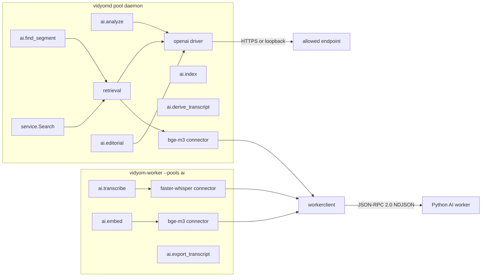

# Component plan: `ai`

Scope of this file: everything the `ai` component delivers, in all phases, per [`00-master-plan.md`](00-master-plan.md) sections 3, 5, 6, 7, 8, 9 and its entry in section 10. Decisions taken to fill gaps are in [`docs/decisions/ai.md`](../decisions/ai.md) as `I200`–`I219`. Everything below is a **target** until committed.

## 1. What this component owns

| Path | Language | Contents |
|---|---|---|
| `aiworker/` | Python | Package `vidyom` (D28): JSON-RPC server per `schemas/ai-worker-rpc.v1.json`, `fake` engine (stdlib only), `real` engine (optional extras) |
| `connectors/ai/workerclient/` | Go | Shared client of the Python worker (Unix socket, loopback TCP, stdio for tests) |
| `connectors/transcription/faster-whisper/` | Go | `fasterwhisper.Register`: `connector.Transcriber` over the client |
| `connectors/ai/bgem3/` | Go | `bgem3.Register`: `connector.Embedder` over the client |
| `connectors/ai/openai/` | Go | `openai.Register`: the single OpenAI-compatible `connector.LLM` driver (D9) |
| `connectors/ai/openai/mockllm/` | Go | Clearly labeled mock endpoint for tests and the demo; no real vendor is ever called (I12) |
| `internal/retrieval/` | Go | Chunking (D15), sensitive-segment redaction (D30), hybrid retrieval and `service.Search` (I43), story detection (§4.4, D51), analysis and editorial prompts |
| `nodes/ai/` | Go | `ainodes.Register`: all catalog-listed `ai.*` nodes |

Nothing here opens a database file. `nodes/ai` and `internal/retrieval` import only contract packages, so linking them into `vidyom-worker` keeps it cgo-free and database-free (`make check-static`).

## 2. How the parts fit

Flow through `ingest-original`: `ai.transcribe` (scratch audio from the master) → `ai.analyze` (LLM if allowed) → `ai.embed` (D15 chunks, BGE-M3) → `ai.index` (stores everything, emits events). `ai.export_transcript` writes open formats to scratch. `create-clip`: `ai.find_segment` proposes candidates for the selection gate. `ingest-derived`: `ai.derive_transcript` → `ai.embed` → `ai.index`, `ai.editorial` drafts metadata.

## 3. Phases

### Phase A: Python worker (roadmap phase 1)

- Packaging: `aiworker/pyproject.toml`, name `vidyom`, stdlib-only core, Python >= 3.12, extras `asr` (`faster-whisper`), `embeddings` (`sentence-transformers`), `all`. Console script `vidyom-ai-worker`, also `python -m vidyom`.
- Protocol: NDJSON framing with the same 64 MiB line limit as `jsonrpc.MaxMessageBytes`, all methods and error codes of the schema, `initialize` first, `$/progress`, `$/cancelRequest`. Long methods run in a thread pool so `health` and cancellation stay responsive; `shutdown` drains in-flight work, then the process exits.
- Transports: `--stdio`, `--socket <path>` (mode 0600 from creation, refuses to replace a non-socket, stale socket detection), `--tcp 127.0.0.1:<port> --token-file <path>` (loopback only, token required, compared in constant time).
- `--engine fake|real` is required, no default, no fallback in either direction (I27).
- `fake` engine: canned transcript scaled to the audio's duration, or the fixture named by `VIDYOM_AI_FAKE_TRANSCRIPT`. Audio duration from WAV headers or Ogg granule positions with the stdlib, `ffprobe` when on `PATH`, otherwise it fails. Embeddings: `fake-hash-embed@1`, byte-for-byte the Go algorithm. Labeled at every surface: startup banner on stderr, `engine: "fake"`, capability `fake`, `health.detail`, `engine: "fake/canned@1"` on the transcript and a first segment stating that the text is canned.
- `real` engine: `faster-whisper` large-v3 and BGE-M3 dense vectors, lazy load, one lock per model so query embeddings never wait for a transcription. No VAD (I11). Missing libraries report `degraded` in `health` and `-32001` on use. Adapter logic is unit-tested with stub modules; real inference runs only where the extras are installed.
- Tests: `unittest` (stdlib), so they run on this host's Python 3.15 with nothing installed.

### Phase B: Go connectors (roadmap phase 1)

- `workerclient`: `unix:///path`, `tcp://127.0.0.1:port` (non-loopback refused), initialize handshake, protocol check, lazy reconnect, progress routing by token, cancellation through `jsonrpc.Conn.Call`, JSON-RPC errors mapped to `errs` codes. One shared connection per endpoint per process.
- Guard against a silent fake (I27): the client refuses a worker whose engine differs from `config.AIWorker.Engine`, whose empty value means `real`. The fake engine is reachable only when configuration says so.
- `faster-whisper` and `bge-m3` connectors: map `aiworker` types to `domain` and `connector` types. `bge-m3` splits into batches of `aiworker.MaxEmbedBatch`. `Info()` reports the actual engine and labels the fake.
- `openai` driver: `POST {baseUrl}/chat/completions`, JSON mode, secret resolved at the moment of use, bounded retries with backoff on 429 and 5xx, response size cap, no redirects, errors that never carry provider bodies or transcript text. D8 hardening: `local`-class endpoints may only dial loopback or private addresses, checked at dial time so DNS cannot move them; `external` endpoints must use HTTPS.
- `mockllm`: deterministic OpenAI-compatible handler answering the three prompts by word overlap, plus a small `main` for `integration` to run in the demo, labeled as a mock.

### Phase C: chunking, redaction and retrieval (roadmap phases 1 and 2)

- `SplitSentences`: sentences with timestamps from word timings, or proportional timing when only segment text exists.
- `ChunkTranscript`: greedy windows of 30–60 s at sentence boundaries, next window starts where overlap is closest to 15%, sentences over 60 s are split at word or proportional boundaries, the tail is merged so it is not under 30 s when the recording allows it. Chapters with a summary become `chapter`-level chunks. Strategy name stored per vector: `sentence-window-30-60s-overlap15@1`.
- `Redact`: removes sensitive intervals from a transcript. With words, only overlapping words go; without words, the whole overlapping segment goes (fail closed). Used before any external LLM call and by `ai.export_transcript`.
- `Fuse`: reciprocal rank fusion, `k = 60`, keyed on asset, version, level and rounded interval (I43).
- `Search`: `service.Search`, modes `hybrid`, `lexical`, `semantic`. Hybrid degrades to lexical with the mode reported when no usable embedder or active model exists. Only vectors of the active model are searched (R18). Hits from non-current versions are dropped because their timelines differ.
- FTS5 query building: user text is tokenized and quoted, so it can never be FTS5 syntax.

### Phase D: story detection, analysis, editorial (roadmap phase 2)

- `Finder`: hybrid retrieval restricted to the asset → context around the top hits → with an allowed LLM, candidates from JSON validated against the transcript and snapped to sentence boundaries → without one, candidates from retrieval expanded by context and stored stories, always ambiguous (I28, D51).
- Modes: `complete_story`, `short` (fits `targetDurationSeconds`), `best_moments` (several disjoint intervals in one candidate, an assembly).
- Evidence: excerpt taken from the transcript, never from LLM text; timestamps; confidence; rationale. Ambiguity rule in I205. Output also states `method` (`llm` or `retrieval`), so the approval shows how the proposal was made.
- The `asset` parameter is reduced to its reference and the asset is re-read from the store; fields in the parameter are ignored, so a workflow cannot widen the AI policy (I208). No hit at all fails the node (I211).
- D8: the effective policy comes from the stored asset and collection, never from node parameters. An endpoint not classified `local` on `local_only` content is treated as absent, even if `env.LLM` returned it. D30: redaction before any non-local endpoint.
- `Analyze`: transcript blocks → summary, chapters, tags, stories; blocks merged; LLM output validated and clamped. No allowed endpoint or a failed endpoint gives `available: false` with a reason (I28, I206).
- `Editorial`: title, description, tags, with the fallback of I28.

### Phase E: nodes (roadmap phases 1 and 2)

Every node returns `schemas.DescriptorFor` as its descriptor and is checked with `schemas.CheckDescriptor`; tests validate parameters and outputs against the catalog's schemas.

| Node | Pool | Environment | Behavior |
|---|---|---|---|
| `ai.transcribe` | `ai` | `AIEnv` | `OpenInput` with `archive` and `proxy` forbidden (D56). Refuses a transcriber declaring capability `external` unless `aiProcessing` is `external_allowed`. Progress forwarded. `timestamp_basis: working_master` |
| `ai.embed` | `ai` | `AIEnv` | D15 chunks, batches. Refuses an external embedder, since no asset policy reaches this pool (I215). Records model, dimensions, chunking |
| `ai.export_transcript` | `ai` | `Env` | JSON, SRT, VTT, Markdown to scratch with SHA-256 and size. Sensitive marks are redacted, or dropped with `excludeSensitive` (D30) |
| `ai.analyze` | `daemon` | `DaemonEnv` | `Analyze` above, usage recorded |
| `ai.index` | `daemon` | `DaemonEnv` | One transaction: transcript, analysis, lexical, vectors, sensitive marks carried from the source through lineage (I207), events `asset.indexed` and `original.indexed`, which fire only when both indexes are non-empty and not again on a retry of a committed attempt. Sets or swaps the active model (I213) |
| `ai.find_segment` | `daemon` | `DaemonEnv` | `Finder` above |
| `ai.derive_transcript` | `daemon` | `DaemonEnv` | Maps source segments and words onto the clip's timeline, intervals concatenated in order |
| `ai.editorial` | `daemon` | `DaemonEnv` | `Editorial` above |

### Phase F: verification

- Go unit tests per package, table and property tests for chunking.
- Fake repositories in tests, with no database. Conformance of `repo.SearchRepo` belongs to `core`.
- Cross-language tests in Go: start the real Python process with the fake engine, over stdio and a real Unix socket; validate every result against `schemas/ai-worker-rpc.v1.json`; compare `aiworker.FakeHashEmbed` with Python over a Unicode corpus.
- End-to-end test in `nodes/ai`: Python worker → `ai.transcribe` → `ai.analyze` with `mockllm` → `ai.embed` → `ai.index` → `ai.find_segment` → `ai.derive_transcript` → `ai.export_transcript`.
- Policy tests that assert on what reached the HTTP mock: no request at all on `local_only` with an external endpoint; no sensitive text in any request on an external endpoint.
- `go vet`, `-race`, and `make check-static` for the binaries that link `nodes/ai`.

## 4. Contract needs

All additive, each its own `contract:` commit (master plan section 7):

- `config.AIWorker.Engine`, optional: which engine the client accepts (I201).
- `domain.Analysis.UnavailableReason`, optional: why `available` is false (I206).
- Doc comment on `domain.SearchHit.Score`: higher is better, cosine similarity for vector hits (I212).
- Extra test vectors in `schemas/ai-worker-rpc.v1.json#/$defs/fakeHashEmbed` for the Unicode cases of I203, so `library` keeps TypeScript identical.

Needed but **not** changed here, because section 7 does not allow it: `paid` on `ai.find_segment` (I216). Listed in the final report.

## 5. Wiring notes for `integration`

- Worker registries: `fasterwhisper.Register`, `bgem3.Register`, `ainodes.Register`. Daemon: the same plus `openai.Register` and `retrieval.New`.
- Driver names: `faster-whisper`, `bge-m3`, `openai-compatible`.
- Start the Python worker with `python -m vidyom --engine fake --socket <path>`, and set `aiWorker.engine: "fake"` in `daemon.json` for the demo.
- The demo's LLM is `connectors/ai/openai/mockllm/cmd/vidyom-mock-llm`.

## 6. Out of scope

Real model accuracy (Validate, I27). VAD (I11). Diarization: the `speaker` field passes through when an engine sets it. Remote AI workers on other hosts. Cost discovery: usage is recorded and `core` prices it from `config.BudgetCosts`. The `public.db` export itself belongs to `publishing`, which consumes the sensitive marks this component stores.
