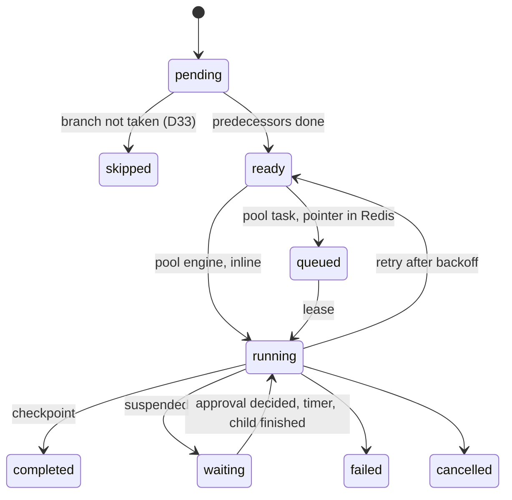

# Component plan: `engine`

Scope: everything the `engine` component delivers in all phases, per [`00-master-plan.md`](00-master-plan.md) sections 3, 5, 6, 7, 8, 9 and its entry in section 10. Decisions that fill gaps are in [`docs/decisions/engine.md`](../decisions/engine.md) as `I140`–`I159`. Everything below is a **target** until committed; the final report states what is real, what is mock-tested and what is a skeleton.

## 1. What this component owns

| Path | Contents | Wiring entry (section 9) |
|---|---|---|
| `internal/workflow` | `${...}` references with the `$${` escape, CEL environment with cost limits, DAG (cycles, ancestors, dominators), validator, `--dry-run`, input binding, required permissions, workflow registry | `workflow.NewValidator(reg)` |
| `internal/queue` | Redis Streams implementation of `jobqueue.Queue` with an atomic enqueue and inflight tracking | `queue.NewRedis(client)` |
| `internal/hooks` | Order, timeouts, failure policies; `hook.Dispatcher` | `hooks.New(...)` |
| `internal/events` | Outbox emit helper, dispatcher, event triggers, plugin subscriptions, delivery tracking, depth and fan-out limits; `service.Events` | `events.New(...)` |
| `internal/scheduler` | Worker registry and resource matching (D40); `every` triggers | `scheduler.New(...)` |
| `internal/jobs` | The engine: job state machine, checkpoints, retries, `needs_attention`, pause, resume, cancel, reconciliation (D4), all of `node.DaemonEnv`; `service.Workflows`, `Jobs`, `Approvals`, `Introspection`, `workerproto.Coordinator` | `jobs.New(jobs.Deps)` |
| `internal/jobs/memstore` | In-memory `repo.TenantStores` used by this component's tests only | |
| `nodes/control` | `flow.if`, `flow.merge`, `flow.wait`, `flow.foreach`, `workflow.execute`, `event.emit` | `controlnodes.Register` |
| `nodes/approval` | `approval.request` | `approvalnodes.Register` |
| `nodes/catalog` | Every `catalog.*` node the catalog assigns to `engine` | `catalognodes.Register` |
| `workflows` | Every workflow file of section 10, embedded by `package workflows` | `workflows.FS` |

Import rule: only `internal/contract/**`, `schemas`, these paths and third-party modules. Everything else is a local fake.

## 2. Phases and order

Each phase ends with a commit that builds and passes its own tests.

| # | Delivers | Proof |
|---|---|---|
| 1 | `contract:` additive edits needed by the design (section 7) | `go test ./internal/contract/... ./schemas/...` |
| 2 | `internal/workflow`: references, CEL, graph, validator, registry | Table tests per rule, every spec example |
| 3 | `workflows/*.json`, valid against the catalog, input names published for `api` and `cli` | One test validates every file with zero warnings; D53 gate test |
| 4 | `internal/queue` | miniredis unit tests; real Redis 8.8 with `FLUSHALL`, kill and restart without data |
| 5 | `internal/hooks`, `internal/jobs/memstore`, `internal/events`, `internal/scheduler` | Unit tests with fakes |
| 6 | `nodes/control`, `nodes/approval`, `nodes/catalog` | `schemas.CheckDescriptor` on all; behavior tests on `memstore` |
| 7 | `internal/jobs`: runtime | Engine tests below |
| 8 | Services, coordinator, dry run, end-to-end of `create-clip` and `ingest-original` over fake worker nodes | §15.5 and §15.7 scenarios |
| 9 | Real Redis engine test, race run, `./...`, final report | Commands in the report |

`internal/workflow` lands first because other components' tests reference workflows; workflow files land immediately after, because `api` and `cli` wait for their input names.

## 3. Execution model

### 3.1 One job, level-triggered

`advance(job)` is the only function that moves a job. It runs under a per-job lock, reads the job and its node records from the tenant database and acts on what it finds, so it can be called any number of times and after any crash. A work queue with de-duplication calls it after each completion, decision, child termination and timer; a sweeper calls it periodically for every active job, so a lost wake-up only costs latency.

Every node gets a `pending` record at submission, in the same transaction as the job.

### 3.2 Node states



Readiness (D33): a node is decided when all its predecessors are terminal. If any required predecessor was skipped or was a `flow.if` with `result: false`, the node is skipped. `flow.merge` is the exception: `all` waits for every input to be terminal and runs if at least one completed; `any` runs on the first completed input; all skipped means skipped. A failed predecessor with `continueOnFailure` counts as completed.

A reference to a node that did not produce output resolves to absent: an object key holding only that reference is dropped, so optional parameters work and required ones fail the catalog schema with a clear error.

### 3.3 Pools

- `engine`: inline in `advance`, through `nodes/control` and `nodes/approval`, with a `ControlEnv` extending `node.DaemonEnv`.
- `daemon`: through Redis like the others (I7). A consumer in the engine reads `vidyom:tasks:daemon`, leases through the same code path as workers and runs the node with `DaemonEnv`.
- `media`, `ai`: leased over `workerproto.Coordinator`. A worker's `node.Env` is `media`'s.

A pointer is written after the commit that marks the node `queued`. A crash in between is healed by reconciliation, which is also why `Enqueue` is a no-op on a known task.

### 3.4 Failure handling (master plan 3.6, D11)

| Class | Transient failure or interruption | Permanent failure | `OutcomeUnknown` |
|---|---|---|---|
| `none`, `idempotent` | Retry with backoff up to the limit, same idempotency key | Node fails | Retry with the same key |
| `reconcilable` | `Reconcile` first, in the daemon pool only: `done` completes, `not_started` retries, `unknown` or an error moves to `needs_attention` | Node fails | Same as transient |
| `unsafe` | `needs_attention` | `needs_attention` | `needs_attention` |

A failed node with `continueOnFailure` does not fail the job. Otherwise no new node starts, in-flight nodes finish, and the job fails. `job retry` resumes from checkpoints.

### 3.5 Terminal writes

Hooks run before the state they announce is written, so a crash in between re-runs them on restart (they must be idempotent, §8.1) instead of losing them: `workflow.after`, `workflow.error` and `workflow.finish` run while the job is still non-terminal, then one transaction writes the terminal state, the outputs and the `workflow.*` event. The same applies to `node.after` and `node.finish`: the output is stored first, the node stays `running` with its output, hooks run, then it becomes `completed`.

### 3.6 Cancel, pause, resume

- Pause: status `paused` at once; in-flight nodes finish and are checkpointed; nothing new starts; a pointer read meanwhile gets `410` and is re-enqueued on resume (R22).
- Cancel: queued work gets `410`, heartbeats carry `cancel: true`, daemon-pool contexts are cancelled, waits and child jobs are cancelled; the job becomes `cancelled` when nothing runs (D11).
- `needs_attention` leaves only through `job resolve` (D11).

### 3.7 Reconciliation (D4)

At startup and periodically, for every tenant and active job: daemon-pool `running` nodes died with the previous process, so they are handled as interrupted; worker-pool leases get a fresh grace period so live workers can heartbeat again; `queued` nodes missing from Redis are re-enqueued. A lease grants exactly one live execution, so a duplicated pointer is harmless (I4).

## 4. Validation

`workflow.Validator` returns `api.ValidationResult`:

1. JSON Schema `workflow.v1.json`.
2. Duplicate node IDs, connections naming unknown nodes, cycles.
3. Node type and version known to the registry or the catalog.
4. Parameters against the catalog: required keys and literal types; a value holding a reference is skipped until runtime, when resolved parameters are validated strictly.
5. Reference grammar, `$${` escape; `${nodes.X...}` requires X to be an ancestor (R24), including `nodes.X` inside CEL; `${inputs.x}` must be declared; `${event...}` needs an event trigger; paths are checked against the output schema when it lists properties.
6. CEL compiled for `flow.if` and trigger filters, never `${...}` inside a condition (D2).
7. Trigger rules (I22), hook rules, approver lists against D7, no literal secret anywhere (§9.1).
8. D53: every `video.cut` is dominated by an `approval.request` of kind `clip_selection` that no `flow.if` can skip.
9. Subworkflows: literal names, recursion refused, child inputs checked.

`--dry-run` adds, without any effect: connectors and capabilities from the tenant's configuration, permissions against the caller, declared resources against registered workers, unknown or `client` credentials on event and schedule workflows (R37).

## 5. Events and hooks

**Events (§8.2).** State change and event commit in one transaction. A dispatcher turns each outbox entry into one delivery per subscriber (`workflow:<id>`, `plugin:<id>`) and marks it dispatched; a delivery loop attempts them with backoff, at least once. Workflow deliveries start a job keyed by event and workflow, so a repeat starts nothing. Chains deeper than `event.MaxCausationDepth` are dropped and recorded, as are subscribers beyond the fan-out limit.

**Hooks (§8.1).** Global, workflow and node hooks, in order global → workflow → node for `before` and `start`, reversed for `after`, `finish`, `error`, `cancel`. Default timeout 30 s, capped by `maxTimeoutSeconds`. `abort`, `retry`, `continue`. A hook returning parameters sends them through validation and permission checks again. A hook can never retry an `unsafe` node (D11).

## 6. Workflow files

`ingest-original`, `ingest-derived`, `create-clip`, `publish-video`, `publish-one`, `unpublish-video`, `delete-asset`, `restore-archived`, `reindex-asset`, `refresh-publication`, `verify-storage`, `bulk-create-clips`, `update-public-library`, `public-library-on-withdrawn`, `public-library-on-updated`, `expire-unapproved-renders`, plus small helpers those need.

`ingest-original` covers R26: original extension in the key, `audio.extract` from the master (D56), `catalog.mark_ready` depending on backup, master, proxy, index and timeline, external catalog outside the condition. `create-clip` covers R27 and D53. Tenants that enable MediaCMS override the file (D24).

## 7. Contract changes expected

All additive, each a `contract:` commit:

- `settings.assetStatusOnFailure` in the workflow schema and `wfdef.Settings`.
- `subworkflows` in the workflow schema and `wfdef.Definition`, for immutable snapshots of a whole job tree (I144).
- `event.Draft.ID`, optional deterministic event ID (I156).
- Catalog entries owned by `engine`: `catalog.get_transcript`, `catalog.list_purgeable_archives` (I159).

Contract fields other components added for this one to fill: `Lease.ScratchJobs`, `Lease.AI`, `jobqueue.ScratchCleanupPointer` (`media`), and the consumer of `plugin.EventSubscriber` (`extensibility`).

## 7.1 Review notes

Reviewed against the spec, the master plan and the other components' plans. What changed:

- `service.Workflows`, `Jobs` and `Approvals` share method names with different signatures, so one type cannot implement them all. `jobs.Engine` exposes `Workflows()`, `Jobs()`, `Approvals()`, `Introspection()` and `Coordinator()`.
- `Coordinator.Lease` receives no tenant. The engine keeps a job-to-tenant map, filled at creation and startup, and scans tenants on a miss.
- `api` rewrites file inputs (I131). The engine applies the same parse again, because `publishing`'s service and child jobs reach it without the API.
- `core` derives asset files and transcript info on read, ignores them on write and rejects invalid transitions, so `catalog.*` writes through `VersionRepo` and `memstore` mimics this.
- `media` refuses `archive` as a source of `storage.put` and refuses non-master sources for `audio.extract`, so `ingest-original` passes `${nodes.store_master.output.uri}` to `audio.extract`.

## 7.2 Wiring for `integration`

```go
nodes := node.NewRegistry()
controlnodes.Register(nodes); approvalnodes.Register(nodes); catalognodes.Register(nodes)
// plus ainodes and publishingnodes, whose daemon-pool nodes the validator requires
validator := workflow.NewValidator(nodes)
registry, err := workflow.LoadRegistry(validator, workflows.FS, cfg.Workflows.Dirs)
sched := scheduler.New(scheduler.Options{Tenants: tenants, Triggers: registry, Workers: system.Workers()})
bus := events.New(events.Options{Tenants: tenants, Triggers: registry, Plugins: pluginRuntime})
engine := jobs.New(jobs.Deps{
	Tenants: tenants, Queue: queue.NewRedis(redisClient), Nodes: nodes, Workflows: registry, Validator: validator,
	Bus: bus, Scheduler: sched, Hooks: hooks.New(pluginRuntime, hooks.Options{}), Config: tenantSource, Daemon: cfg,
	Storage: storageResolver, Publishing: publishingResolver, Connectors: connectors, SecretsFor: secretsFor,
	Keys: derivedKeys, Budgets: budgets, Plugins: system.Plugins(), Metrics: metrics, Logger: logger,
})
go engine.Run(ctx) // reconciliation, daemon pool, timers, Event Bus, schedules
// API: engine.Workflows(), Jobs(), Approvals(), Introspection(), Coordinator(), and engine.Bus() as service.Events.
```

## 8. Tests

- `internal/workflow`: every validation rule, positive and negative; resolver; CEL cost limit.
- `internal/queue`: miniredis; real Redis (`mise exec redis@8.8.0 -- redis-server`, non-default port, temporary directory, skipped with a stated reason when absent).
- `internal/jobs` over `memstore` and a fake worker through the coordinator: branching and merge; checkpoints; retry per class; `reconcilable` before retry; `unsafe` to `needs_attention`, every resolve action and permission; pause and resume; cooperative cancel; approval levels (D7), adjust, timeout policies; subworkflow isolation and immutable snapshots; foreach limits; hook order and policies; event trigger, filter, depth limit, duplicates; budget pause (I33); restart at every stage; `FLUSHALL`; tenant isolation.
- End to end over fake nodes: `ingest-original` to `ready_for_clipping`, `create-clip` through both gates.
- `go vet`, `-race` on all own packages.
- `internal/jobs` tests take their store from one variable, so they can also run on `core`'s real SQLite store. `integration` should do that: it is what proves the fake's fidelity.

## 9. Out of scope

Node implementations of other components. `webhook` triggers refuse with `not_implemented` (I22). Cron expressions stay reserved. Multi-source clips stay Future (R12), declared lineage stays Future (D50).
