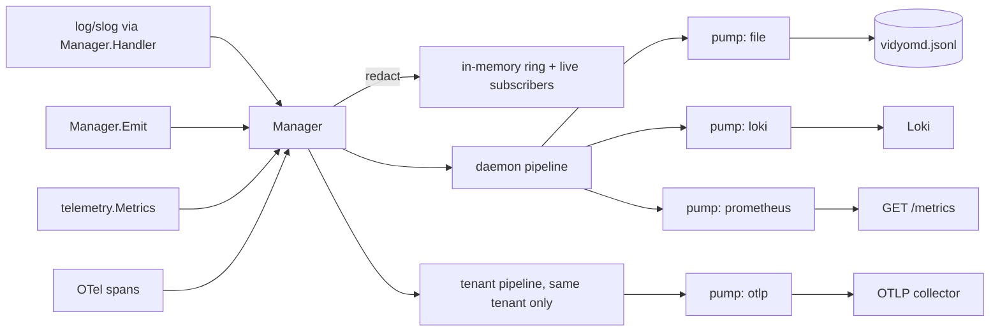
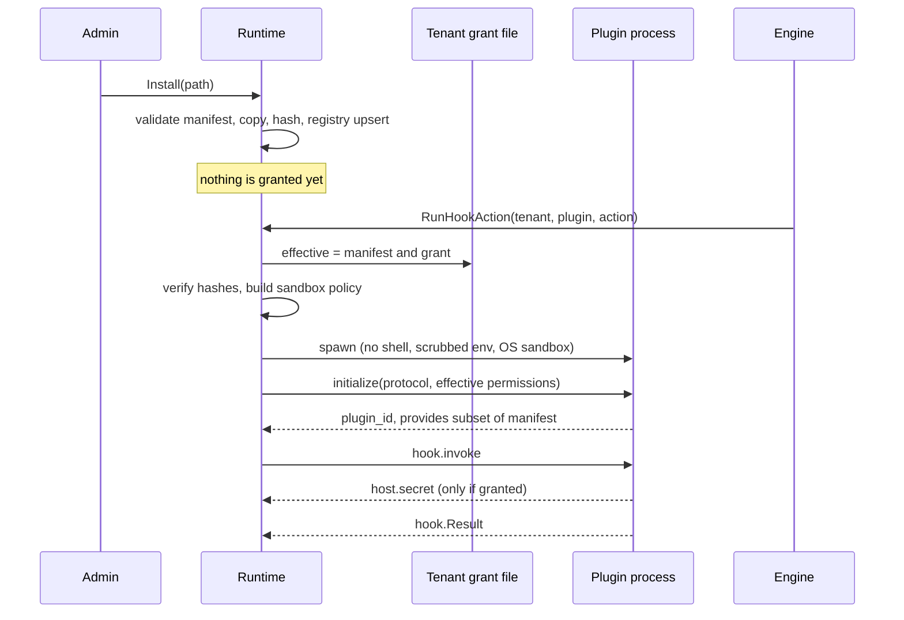

# Plan: component `extensibility`

Owner of `internal/plugins/**`, `plugins/**`, `internal/observability/**` and `connectors/observability/**`. Normative inputs: `spec/vidyom-specification-v1.2.md` (§5.6, §7.4, §7.6, §8.1, §8.2, §9.4, §10, §15.7, Phase 4, D3, D6, D38, D43), `docs/plans/00-master-plan.md` (sections 3, 5–10), `docs/decisions.md` (I42, I34, I32, I11, I12), `internal/contract/**`.

Status vocabulary: everything below is a **target** until its commit lands. Decisions taken while reviewing this plan are in [`docs/decisions/extensibility.md`](../decisions/extensibility.md) as `I260–I279`.

## 1. Deliverables

| Package | Entry point (master plan §9) | Provides |
|---|---|---|
| `internal/plugins` | `plugins.New(plugins.Options) (*plugins.Runtime, error)` | `service.Plugins`, `hook.ActionRunner`, `plugin.EventSubscriber` (new additive contract) |
| `plugins/sample-notifier` | binary plus `vidyom-plugin.json` | sample Go plugin used by tests and documentation |
| `internal/observability` | `observability.New(config.Observability, ...Options) (*observability.Manager, error)` | `service.Observability`, `telemetry.Metrics`, `http.Handler` for metrics, `slog.Handler`, an OpenTelemetry `TracerProvider`, instrumentation helpers |
| `connectors/observability/file` | `file.Register(connector.Registrar)` | `LogSink` `file`: JSONL, daily rotation, retention, local query |
| `connectors/observability/loki` | `loki.Register(connector.Registrar)` | `LogSink` `loki`: HTTP push API |
| `connectors/observability/prometheus` | `prometheus.Register(connector.Registrar)` | `MetricsExporter` `prometheus` with `MetricsHandler` |
| `connectors/observability/otlp` | `otlp.Register(connector.Registrar)` | `MetricsExporter` and `TraceExporter` `otlp` over OTLP/HTTP |

Import rules: `internal/plugins` and `internal/observability` depend on `internal/contract/**`, `schemas` and third-party modules only. `internal/observability` and its connectors stay cgo-free and database-free, so `vidyom-worker` may link them. `internal/plugins` runs only in `vidyomd` (hooks run in the engine) but stays cgo-free too and compiles on Linux, macOS and Windows.

Out of scope, as the master plan states: native Go `.so` plugins (excluded by §7.6), WASM (Future), remote plugins over HTTPS (refused, I42), Datadog (Future, I11), browser UI of any kind.

## 2. Contract additions (additive only, each a `contract:` commit)

Section 7 of the master plan allows these. None changes an existing name, type or meaning.

| Package | Addition | Why |
|---|---|---|
| `plugin` | `InitializeParams.TenantID`, `InitializeParams.TempDir`; methods `host.secret` (request) and `host.log` (notification) with their types; `EventSubscriber` interface | The method set only had daemon-to-plugin calls, so there was no permission-checked way for a plugin to get a secret. Nothing told the engine how to reach plugin subscribers |
| `config` | `Daemon.Plugins` (`dir`, `installRoots`, `allowUnsandboxed`, `runtimePaths`) | Runtime settings need a home in `daemon.json` |
| `domain` | `PluginRecord.Isolation`, `PluginRecord.TenantGrant` (both computed at read time, not persisted) | `vidyom plugin inspect` has to state what isolation is real and what this tenant granted |
| `connector` | `LogQuerier`, `LogQuery`, `LogPage` | `GET /logs` must read local logs through the sink that keeps them (§10.1) |
| `telemetry` | `SystemTenant`, `MetricSpec`, `Catalog`, `Spec`, and the §10.3 metrics that had no constant | Label sets have to be known to exporters; `tenant_id` is mandatory on every metric (D6) |

## 3. Observability design

### 3.1 Flow

### 3.2 Pump: the isolation unit

One generic `pump[T]` per sink instance: its own bounded ring queue and its own goroutine.

- `push` never blocks. A full queue drops the oldest entry and counts it.
- The goroutine opens the sink itself, so a sink that hangs at open or at write delays only itself.
- Batches by size and interval, one write at a time with a per-write timeout.
- On failure: bounded exponential backoff, a bounded number of attempts per batch, then the batch is dropped and counted. The queue keeps absorbing meanwhile, so a sink that comes back receives what is still buffered.
- A panic in a sink is recovered and treated as a failed write.
- Exposes backlog, dropped, failures, last error (redacted), last success and delivery delay.
- `Flush` and `Close` take deadlines. A hung sink cannot stop shutdown.
- A failure record is written on the transition to failing and at most once a minute while it lasts, to the ring and every other sink, never back into the failing one (§15.7).
- Exporter health metrics are read from pump counters on a ticker, not pushed from inside the pump, so a failing metrics exporter cannot feed itself.

### 3.3 Redaction

`Redactor` is applied to every log record, span attribute and error string before anything leaves the manager. Key rules cover fields whose name marks them sensitive, including private transcript content (§9.4). Value rules cover bearer tokens, `vdm_` device credentials (I17), JWTs, signed URL parameters, URL user information, PEM blocks and cloud key shapes. Exact secret values can be registered at run time. Structured values are walked; unknown types go through a JSON round trip so a struct field cannot bypass the walk.

### 3.4 Pipelines and tenancy (D6)

Two kinds of pipeline: the daemon's (`config.Daemon.Observability`), and one per tenant (`config.Tenant.Observability`, loaded lazily through `config.TenantSource`, never from the record path). A record or metric goes to the daemon pipeline and to the pipeline of its own tenant, never another's. `Logs`, `SubscribeLogs` and `Sinks` filter by `Scope.Tenant`. `GET /metrics` filters to the tenant named in `Vidyom-Tenant`.

### 3.5 Defaults (D38)

No log sinks configured: an implicit `file` sink at `<logDir>/vidyomd.jsonl`. No metrics configured: an implicit `prometheus` exporter. An in-memory ring keeps recent records whatever is configured, so `GET /logs` has an answer even with no sink at all (§10.1).

### 3.6 Metrics

`telemetry.Catalog` lists every metric of §10.3 with its kind, labels and help text, always including `tenant_id`. The manager normalizes labels to the catalog and fills a missing `tenant_id` with `telemetry.SystemTenant`. The `prometheus` connector keeps its own registry so tests and tenants never share global state. Host metrics of workers come from `observability.StartHostSampler`.

### 3.7 Tracing helpers

`Manager.TracerProvider` (SDK provider whose span processor converts to `connector.SpanRecord` and fans out through pumps), `Manager.InstallGlobals`, `StartSpan`, `EndSpan`, `TraceID`, `ExtractTraceParent`, `InjectTraceParent`, `TraceMiddleware`, `TracingTransport`, `ObserveDuration`.

### 3.8 Connectors

- **`file`.** `parameters`: `path`, `rotation` (`daily`, `none`), `retentionDays`. UTC day boundary, rotated names `vidyomd-YYYY-MM-DD.jsonl`, retention sweep at open and at rotation, `fsync` on `Flush`, `LogQuerier` with newest-first pages and an opaque cursor.
- **`loki`.** `parameters`: `url`, `orgId`, `labels`, `timeoutSeconds`. Stream labels are low-cardinality only (`service`, `level`, `tenant_id`). Gzip JSON to `/loki/api/v1/push`, split by size. `credentialsRef` resolved at open. Refuses user information in the URL and credentials over plaintext to a non-loopback host.
- **`prometheus`.** Own registry, histogram buckets for long media jobs, series cap per metric, tenant-filtered gatherer.
- **`otlp`.** `parameters`: `endpoint`, `timeoutSeconds`, `intervalSeconds`. Official OTLP/HTTP exporters. `SpanRecord` to SDK snapshot. `MetricPoint` to SDK instruments with a periodic reader.

All tested against local mocks only (`httptest`). No real Loki, Datadog or OTLP endpoint is contacted (I12).

### 3.9 Service

`Logs` (file sink's `LogQuerier`, falling back to the ring), `SubscribeLogs`, `Sinks`, `TestSink` (one direct write, serialized with the pump), `SetSinkEnabled` (audited, persisted in an overlay file so a restart does not silently undo it), `MetricsHandler`.

## 4. Plugin design

### 4.1 Lifecycle

### 4.2 Manifest validation

Schema (`schemas/plugin-manifest.v1.json`) plus semantic rules: strict decode, full semver (the schema's pattern only checks a prefix, and the version becomes a path), entrypoint relative with no `..`, regular executable file in the tree, `sha256` of the entrypoint matches when present, known contract families and compatible majors, permission syntax, event subscriptions covered by `permissions.events`. `runtime: remote` is valid against the schema and refused by `plugins.Validate` and at start (I42). A manifest declaring what this version cannot activate is refused with `not_implemented` rather than accepted and silently ignored.

### 4.3 Registry and install

`repo.PluginRepo` in `system.db`. `Install`: requires `plugin.install` and system admin, because a plugin runs on the host for every tenant that enables it. The path must be inside a configured install root. Files are copied to `<dir>/<id>/<version>-<hash12>/`, read-only, refusing symlinks, devices, setuid bits and oversized trees. The tree digest covers every file and is stored in `PluginRecord.SHA256`. Re-installing the same version with different content is a conflict. Audited.

### 4.4 Permissions: nothing granted automatically

The manifest **declares** the most a plugin may ask for. A tenant **grants** explicitly in `<config-dir>/tenants/<tenant>/plugins.json` (I34 style, references only). Effective permissions are the intersection. With no grant entry the plugin does not run for that tenant.

| Permission | Enforcement |
|---|---|
| Secrets | Reverse RPC `host.secret` checks the effective list, resolves through that tenant's `SecretResolver`, audits by name. Never in environment or arguments. Values given to a process are scrubbed from its logs |
| Filesystem | OS sandbox allow-list. `job-temp` is a private temp directory removed at exit. Declared absolute paths, `ro:` for read-only. Overlap with data, config, cache, spool or scratch directories is refused |
| Network | OS sandbox denies everything except a per-process loopback egress proxy that enforces the host allow-list. No grant, no proxy and no network |
| Events | `event.deliver` only for types in effective `permissions.events` and only for the process's own tenant |
| Command execution | Not grantable in this version. Only the entrypoint and operator-declared runtime paths may be executed |
| Environment | Scrubbed: the daemon's environment, including any master key, is never inherited |

The OS sandbox is Landlock plus seccomp on Linux and Seatbelt on macOS. When it is not available the plugin is refused, unless the operator set `plugins.allowUnsandboxed`, in which case `isolation: none` is reported wherever the plugin is shown.

### 4.5 Process runtime

One process per tenant and plugin (D6), started on demand, stopped when idle. JSON-RPC 2.0 NDJSON over stdin and stdout through `internal/contract/jsonrpc`. Stderr is drained, redacted and logged. Handshake with a timeout; the answer must name the right plugin and protocol and provide nothing beyond the manifest. Hash verification on every start; a mismatch disables the plugin and audits. Crash loop backoff, in-flight limit, flood guard, process group kill, graceful `shutdown` with a deadline.

### 4.6 `hook.ActionRunner` and events

`RunHookAction` resolves plugin and grant, checks the action against `provides.hookActions`, applies the hook's timeout, and maps every failure to a coded error whose message is redacted. `Reason` from the plugin is redacted. Failure policies, ordering and re-validation of modified parameters stay in the engine's dispatcher (§8.1). `EventSubscribers` and `DeliverEvent` serve the engine's Event Bus, which owns delivery tracking and retries.

## 5. Phases

| Phase | Work | Paths | Done when |
|---|---|---|---|
| 1 | Contract additions | `internal/contract/{plugin,config,domain,connector,telemetry}` | Contract tests pass, committed immediately |
| 2 | Redactor and pump | `internal/observability` | Unit tests with a blocking sink, a failing sink and a panicking sink; drop-oldest proven |
| 3 | `file` connector | `connectors/observability/file` | Rotation across a fake clock, retention, query, restart |
| 4 | `prometheus` connector | `connectors/observability/prometheus` | Every catalog metric exposed with `tenant_id`; tenant filter |
| 5 | Manager | `internal/observability` | Fan-out, tenant routing, slog handler, service methods, defaults |
| 6 | `loki` connector | `connectors/observability/loki` | Mock Loki: format, auth, gzip, 5xx; dead Loki blocks nothing |
| 7 | `otlp` connector and tracing helpers | `connectors/observability/otlp`, `internal/observability` | Mock collector decodes real OTLP protobuf; traceparent round trip |
| 8 | Host sampler | `internal/observability` | Worker metrics set on this host |
| 9 | Manifest, hashing, registry, install | `internal/plugins` | Negative manifest table; tamper detection; path and symlink attacks refused |
| 10 | Isolation | `internal/plugins` | Probe plugin denied filesystem, network and exec on macOS and in a Linux container |
| 11 | Process runtime, grants, secrets, proxy | `internal/plugins` | Handshake, crash, timeout, flood, secret gating, proxy allow-list |
| 12 | Hook runner, events, sample plugin | `internal/plugins`, `plugins/sample-notifier` | Sample plugin blocks a source, records a finish, receives events at least once |
| 13 | End-to-end check and report | all | `go vet`, `-race`, Linux container, cross-compile, `./...` for the report |

## 6. Testing

- **Real in tests:** child processes speaking JSON-RPC, Seatbelt on this host, Landlock and seccomp in a `golang:1.27-bookworm` container named `vidyom-dev-extensibility-*`, Prometheus text output, real OTLP protobuf encoding, files on disk.
- **Mock-tested only:** Loki and OTLP collectors (`httptest`).
- **Local fakes:** `repo.PluginRepo`, `security.Auditor`, `connector.SecretResolver`, `config.TenantSource`.
- `go test -race` on all owned paths, plus `GOOS=windows`, `GOOS=linux` cross builds.

## 7. Wiring notes for `integration`

Collected in the final report: `observability.New`, `plugins.New`, grant file location, install roots, `daemon.json` additions, passing `Manager.Handler` to `slog`, `Manager.InstallGlobals`, plugin deliveries to the Event Bus, and the Prometheus scraper's credential.
