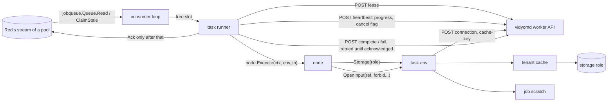

# Component plan: `media`

Scope of this file: everything the `media` component delivers, in all phases, per [`00-master-plan.md`](00-master-plan.md) sections 3, 5, 6, 7, 8, 9 and its entry in section 10. Decisions taken to fill gaps are in [`docs/decisions/media.md`](../decisions/media.md) as `I180`–`I199`. Everything below is a **target** until committed; the final report states what is real, what is mock-tested and what is a skeleton.

## 1. What this component owns

| Path | Contents |
|---|---|
| `cmd/vidyom-worker/main.go` | Flags, config loading, `wireRegistries` seam (section 9). `wire.go` belongs to `integration` |
| `internal/workers/` | `workers.Run`: register, node heartbeat, per-pool consumers, lease, task heartbeat, cancel, complete or fail, ack. `node.Env` and `node.AIEnv` implementations, scratch, input resolution |
| `internal/workers/client/` | HTTP client of `/api/v1/worker/...`, implementing `workerproto.Coordinator` over Unix socket or HTTPS |
| `internal/workers/cache/` | Per-tenant encrypted cache (D22, I39) |
| `internal/workers/ffmpeg/` | `ffmpeg` and `ffprobe` runners (argv only, never a shell), probe, VFR and timestamp detection, encode argument builders, timeline tolerance |
| `internal/workers/workertest/` | Test helpers shared by the node packages: real `node.Env` on a temp tree with the `local` driver, fixture generators |
| `connectors/storage/local/` | `local` driver (I9) with access log |
| `connectors/storage/gcs/` | `gcs` driver (§7.2), tested against `fake-gcs-server` |
| `connectors/storage/resolver/` | `connector.StorageResolver` and `service.Storages` |
| `connectors/storage/storagetest/` | Conformance suite every storage driver runs |
| `nodes/storage/` | `storagenodes.Register`: `storage.put`, `get`, `verify`, `delete`, `copy` |
| `nodes/video/` | `videonodes.Register`: `video.probe`, `transcode`, `validate_timeline`, `preview`, `cut`, `thumbnail` |
| `nodes/audio/` | `audionodes.Register`: `audio.extract` |
| `profiles/` | `master-1080p`, `master-2160p-hevc`, `proxy-720p`, `speech-opus`, each with `version`, embedded by `package profiles`, validated against `schemas/media-profile.v1.json` |

The worker stays `CGO_ENABLED=0` and free of database packages. `internal/workers` never imports `nodes/*`; only `wire.go` and tests do. Nothing here imports another component's implementation.

## 2. Runtime design

### 2.1 Worker loop (`workers.Run`)

`workers.Run(ctx, workers.Config, node.Registry) error`. `Config` carries the coordinator, the queue (I180), the connector registry, the pools and the directories; `cmd/vidyom-worker` builds it (I196).

1. **Startup checks.** Fail before registering when `ffmpeg` or `ffprobe` is missing or too old in a `media` pool (I190), or when a directory cannot be created. Log versions.
2. **Register** with `worker_id` (`<host>-<pid>-<random>`), pools, resources (CPU, memory, disk free under scratch, GPU flag, max concurrency) and version. Retry with backoff while the daemon is unreachable, fail at once on `unauthenticated`. Reject a daemon with another `protocol_version`.
3. **Node heartbeat** every `heartbeat_seconds` with running count and free disk. A daemon outage does not stop running tasks.
4. **One consumer per pool**, sharing the concurrency limit. `Read` with `Count` equal to free slots and a short block. `ClaimStale` periodically, skipping tasks already running here.
5. **Task runner** for each delivery:
   - `Lease`. `410`: ack and drop. `409`: leave unacked for another worker. Other errors: leave unacked, `ClaimStale` brings it back.
   - Unknown node type or pool mismatch: `Fail`, not retryable.
   - Build the task env. Start the task heartbeat with latest progress. `Cancel: true` cancels the node's context only when the descriptor has `SupportsAbort`; otherwise the node finishes (D11). `410` on heartbeat cancels the node and drops its result.
   - A failed heartbeat is not fatal: the lease is enforced by the daemon when the result arrives, so a daemon restart during a long transcode loses nothing. After `DaemonOutageLimit` the node is aborted (I194).
   - `Execute` with panics recovered. Enforce the 32 MiB output cap (I35). A `Suspend` from a worker-pool node is an internal error.
   - `Complete` or `Fail`, re-delivered with backoff until acknowledged (I4). Only then `Ack`. `410` on complete means someone else owns it: ack and drop.
   - Remove the task's plaintext input copies whatever the outcome.
6. **Failure mapping.** `errs.CodeOf` gives `Code`, `errs.Public` gives the message, so internal causes never leave the worker. `node.IsTransient` gives `Retryable`, `node.IsUnknownOutcome` gives `OutcomeUnknown`. `Code: "cancelled"` after a cooperative abort.
7. **Shutdown.** Context cancelled: stop reading, wait up to `ShutdownGrace`, then cancel running nodes and report them as retryable failures.
8. **Task logs.** `Env.Logger()` writes JSON to stderr and forwards batched lines through `TaskLogs`.
9. **Cleanup pointers.** A pointer of type `jobqueue.NodeTypeScratchCleanup` removes that job's scratch and is acked, with no lease (I181).
10. **Metering.** The environment counts storage bytes and the runner adds usage records to `complete` (I195).

### 2.2 Task environment

Implements `node.Env`, plus `node.AIEnv` for pool `ai`, built from the lease (the tenant comes only from the lease):

- `Storage(role)`: `Connection` for the role (memoized for the task, memory only), then the driver factory from the connector registry, with a `SecretResolver` that answers the instance's `credentialsRef` from the leased credentials and refuses any other.
- `OpenInput(ref, forbid...)`:
  - `server:` through `domain.ResolveServerPath` with the configured `ingestRoots`.
  - `upload:` from `<spool-dir>/<tenant>/<ulid>`; a friendly reference only through a same-named link (I183).
  - `storage://` through the cache: `Stat` for the authoritative checksum, then hit or fill, then a plaintext copy in the task's temp area. `Role` and `SHA256` are always set.
  - `scratch://` through `Scratch.Resolve`, plus the origin sidecar (section 2.5), which gives `Role`.
  - `import:` returns `errs.NotImplemented` (I11).
  - `forbid` is checked first, on the parsed reference and on the role a scratch sidecar records.
- `HasPermission`: from the lease.
- `Transcriber`, `Embedder`: from the connector registry with `connector.AIParams` (I197).

### 2.3 Scratch

`<scratch-dir>/<tenant>/<job-ulid>/<node-id>/<file>`, URI `scratch://<job-ulid>/<node-id>/<file>` (I5). The tenant is taken from the lease, never from the URI. Plaintext input copies live in a hidden per-task directory, deleted at task end.

`Resolve` accepts the job's own files and those of `Lease.ScratchJobs` (I182). Whole-job cleanup is `media`'s (I45): a cleanup pointer at job end, a 7-day idle reaper as the net (I181).

### 2.4 Cache (D22, I39)

`<cache-dir>/<tenant>/<entry-id>.vcache`. The entry ID is an HMAC of role, key and origin checksum under the tenant key, so file names reveal nothing.

- Encrypted with chunked AES-256-GCM in a STREAM construction (chunk index and a final flag in the nonce and AAD), under a per-file key derived with HKDF from the tenant key and a random salt in the header. A truncated, reordered or foreign file fails authentication. The tenant key comes from `CacheKey` per lease and stays in memory.
- The authenticated header records role, key and origin SHA-256. Reuse decrypts, recomputes SHA-256 and compares with the origin and with `Stat`, so a stale or tampered entry counts as a miss, is deleted and is downloaded again (`video.cut` checks both, §6.4).
- LRU by a last-used time kept in the file's modification time, so eviction needs no key. Idle expiry 7 days (`retention.cacheIdleDays`), maximum size per tenant (`retention.cacheMaxBytes`). Swept hourly and after each fill.
- Two tasks filling the same entry never see a partial file: temp file, fsync, atomic rename.

### 2.5 Origin sidecars (I185)

`storage.get`, `video.cut` and `video.transcode` write `<file>.origin.json` beside their scratch output, recording `role`, `key`, `sha256`, `profile` and `family`. This is how a scratch file keeps its provenance, so `video.cut` can accept "a local cache derived from" the master (§6.4), and `audio.extract` can refuse a file derived from the proxy (D56). A scratch file with no sidecar has no role and is refused by both. `storage.put` copies `profile` into its output.

### 2.6 FFmpeg

Single runner: `exec.CommandContext(ctx, bin, argv...)`, never a shell, no string concatenation that becomes a command (§6.5). Paths are absolute, so none can be taken as an option. On cancel: `SIGTERM`, then kill after a delay. Progress from `-progress pipe:1`. Stderr kept as a bounded tail for internal logs, never returned to clients. Minimum FFmpeg version checked at startup.

Hardened input: every input gets a demuxer whitelist and a protocol whitelist, so an uploaded HLS playlist or concat script cannot read local files or reach the network (I190).

Every encode uses `-map_metadata -1`, one video and one audio stream, faststart for MP4, temp name then rename, and SHA-256 of the output. Timeline rules, including how VFR is detected and which rate it becomes, are in I191.

## 3. Nodes

Every node returns `schemas.DescriptorFor(type, 1)`, and a test calls `schemas.CheckDescriptor` and validates its output against the catalog's output schema. Errors are classified: `node.Transient` for storage unavailability, `node.Permanent` for everything else. `Result.Tools` records the FFmpeg version for provenance (R21). Paid nodes report `Result.Usage` with quantity and unit; pricing is the daemon's.

| Node | Behavior | Refuses |
|---|---|---|
| `storage.put` | Source to role and key. With `verifyChecksum`, source hash is compared by the driver at write time (no read of the role afterwards) and confirmed through `Stat`. A retry finding the same checksum at the key skips the upload | `archive` as a source |
| `storage.get` | Through the verified cache to scratch, with origin sidecar | `archive` unless `allowArchive` and the job holds `storage.archive.restore`; any role in `forbidStorageRoles` |
| `storage.verify` | `Verify` against `sha256` or the recorded checksum. On `gcs` no read happens (I186); on `local` it counts as class `verify` in the access log (I188). `allowArchive` alone suffices, because no media leaves the driver | `archive` unless `allowArchive` |
| `storage.delete` | Missing is success, `deleted: false` | |
| `storage.copy` | Between roles: server-side when both ends can, otherwise streamed with checksum | Reading `archive` unless `allowArchive` and `storage.archive.restore` |
| `video.probe` | ffprobe plus a packet scan: duration, display dimensions, fps, `vfr`, `broken_timestamps`, codecs, container, `ext` | |
| `video.transcode` | Named profile or `auto:master` (I25, I184). Never upscales. VFR or broken timestamps normalized to CFR (I191). Same zero instant. Checks its own output's duration. Records `id@version` | Audio-only profiles; `archive` as a source |
| `video.validate_timeline` | Each candidate against the reference, tolerance max(100 ms, 1 frame of the reference). Above it: permanent `validation_failed` with the durations; `valid: true` otherwise (I191) | `archive` as a reference or candidate |
| `video.preview` | Low-cost render of the segments, from the proxy or a scratch file (§3.2, I192) | `archive`, `master` |
| `video.cut` | Frame-accurate re-encode of the segments, at the source's master profile unless `profile` is given, never upscaled. Returns the interval map. Checks the output's duration against the segments (I192). Requires `DirectAccess` on the `master` instance | Everything without role `master` and a checksum: `archive`, `proxy`, `server:`, `upload:`, scratch without a master sidecar. No fallback (§6.4) |
| `video.thumbnail` | One JPEG at `atSeconds`, clamped into the duration, default a tenth of the way in | `archive` |
| `audio.extract` | ASR profile (default `speech-opus`) from the master (D56). Mono, 16 kHz at most, bitrate never above the source's (D40). Pads a short track so the file has the master's timeline. Fails when the source has no audio (I193) | `proxy`, `archive`, `server:`, `upload:`, scratch without a role or family `master` |

## 4. Storage drivers

Both implement all of `connector.Storage`. Object names are `<instance prefix>/<tenant>/<key>` (D6). `domain.ValidateStorageKey` runs on every key. `Capabilities().DirectAccess` comes from the instance's `usage`, never from the driver name.

**`local` (I9).** Root per role, atomic rename, fsync of file and directory, and traversal-resistant file access through `os.Root`. Checksums in a metadata tree beside the data. Write-time verification hashes while writing and re-reads the temp file before the rename. Generations retained on overwrite (I187). Optional JSONL access log: `at`, `tenant`, `role`, `op`, `class` (`read`, `verify`, `write`, `metadata`), `key`, `bytes` (I188). A `disableCapabilities` parameter lets tests prove that a missing capability is declared and fails explainably (§15.4). Proxy links are `file://` (I198).

**`gcs` (§7.2).** `cloud.google.com/go/storage`. Credentials through `credentialsRef`, no implicit environment credentials (I199). Writes: SHA-256 and CRC32C while streaming, abort before commit on a mismatch, compare the server's CRC32C afterwards, keep both as object metadata; `Verify` needs no read (I186). `Location.Generation` from the object. Signed URLs for proxy links (I198). Tested against `fake-gcs-server`, in a container with a `vidyom-dev-media-` name on a non-default port when Docker is available, and in-process otherwise, through the same conformance suite. Real GCS is never contacted.

**`resolver`.** `resolver.New(resolver.Options)` gives `connector.StorageResolver` and `service.Storages` (`List`, `Test`, `Verify`, `ProxyLink`) for the daemon, reading `config.TenantSource` and refusing a configuration that fails `config.ValidateStorages` (R28). The worker opens instances through `resolver.Open`, with what `Connection` returned. `Test` is non-destructive on `archive` (R29): a listing and a probe of a missing key, while operational roles also do a small write, read and delete. `Verify` and `ProxyLink` read asset files through a narrow interface that `service.Assets` satisfies.

## 5. Phases

| Phase | Delivers | Proof |
|---|---|---|
| 0 FFmpeg proof | `internal/workers/ffmpeg`, fixtures, `profiles` | Real encodes on generated fixtures: CFR, VFR, broken timestamps, offset start, rotated, no audio |
| 1 Storage | `storagetest`, `local`, `gcs`, `resolver` | Conformance on both, `fake-gcs-server` container |
| 1 Cache | `internal/workers/cache` | LRU, idle expiry with a fake clock, tamper and truncation, foreign-tenant refusal, no plaintext on disk |
| 1 Worker | `workers.Run`, client, env, scratch, `cmd/vidyom-worker` | In-process HTTP daemon fake and in-memory queue: lease outcomes, heartbeat, cancel, re-delivery, shutdown, panic, output cap |
| 1 Ingest nodes | `storage.*`, `video.probe`, `transcode`, `validate_timeline`, `audio.extract` | §15.1 items 2, 3, 8 on real FFmpeg |
| 2 Clip nodes | `video.preview`, `cut`, `thumbnail` | §3.2 invariants: no `archive` read in the access log, `video.cut` refusals, cached master reuse |
| 3 Hardening | Whole-chain test through the real worker loop, cross-compilation, `make check-static` | §1.1 steps 3 and 6 as far as `media` reaches |

Publishing, the AI nodes and the catalog are other components'. `media` provides what they call.

## 6. Questions settled in the review

| Question | Decision |
|---|---|
| Where does the worker get its `jobqueue.Queue`? `internal/queue` is `engine`'s | Second seam in `main.go` (I180) |
| How does a worker learn that a job ended, to delete its scratch? | Cleanup pointer, idle reaper (I181) |
| `workflow.execute` passes a parent's `scratch://` to a child job | `Lease.ScratchJobs` (I182) |
| `upload:UPL-001` reaches a worker, the spool is named by ULID | The daemon rewrites to the ULID (I183) |
| 1440p sources; portrait recordings | Short side decides (I184) |
| `Verify` on `ARCHIVE` without paying for retrieval | Recorded CRC32C against the server's (I186) |
| What is honest for "full capability set" | Table in I187 |
| Tenant AI settings in the AI pool | `Lease.AI`, optional (I197) |
| A proxy link on `local` | `file://`, stated as such (I198) |
| Cache maximum and FFmpeg parameters | I189, I190, I191, I192 |

Contract additions, each its own `contract:` commit: `jobqueue.NodeTypeScratchCleanup`, `jobqueue.ScratchCleanupPointer`, `workerproto.Lease.ScratchJobs`, `workerproto.Lease.AI`. All optional: the worker runs without them, with the limits each decision states.

### Needs from other components, for `integration`

- `engine`: enqueue `ScratchCleanupPointer` at terminal job states; fill `Lease.ScratchJobs` for child jobs; fill `Lease.AI`.
- `api` or `engine`: rewrite `upload:UPL-nnn` to the ULID form on accepting a run (I183).
- `cmd/vidyom-worker/wire.go`: set both `wireRegistries` and `wireQueue`.
- Tenant `storages.json` must declare `usage: operational` on `master` and `proxy` (I187).

## 7. Tests

- Own paths, `go vet`, `-race` where cgo allows (this component has no cgo, so always): `go test -race ./internal/workers/... ./nodes/storage/... ./nodes/video/... ./nodes/audio/... ./connectors/storage/... ./profiles/... ./cmd/vidyom-worker/...`.
- `CGO_ENABLED=0 go build ./cmd/vidyom-worker`, `make check-static`, cross-compile for Linux, macOS and Windows.
- Fixtures generated by FFmpeg under a temp directory, small and short. No media is committed.
- Containers named `vidyom-dev-media-*`, on non-default ports, removed by the test.

## 8. Out of scope

VAD (I11). `import:` connectors (I11). S3, Dropbox, SFTP drivers (Future). Hardware encoders. Real GCS (`Validate`). `restore-archived`, `verify-storage` and friends are workflow files owned by `engine`; `media` provides their nodes.
