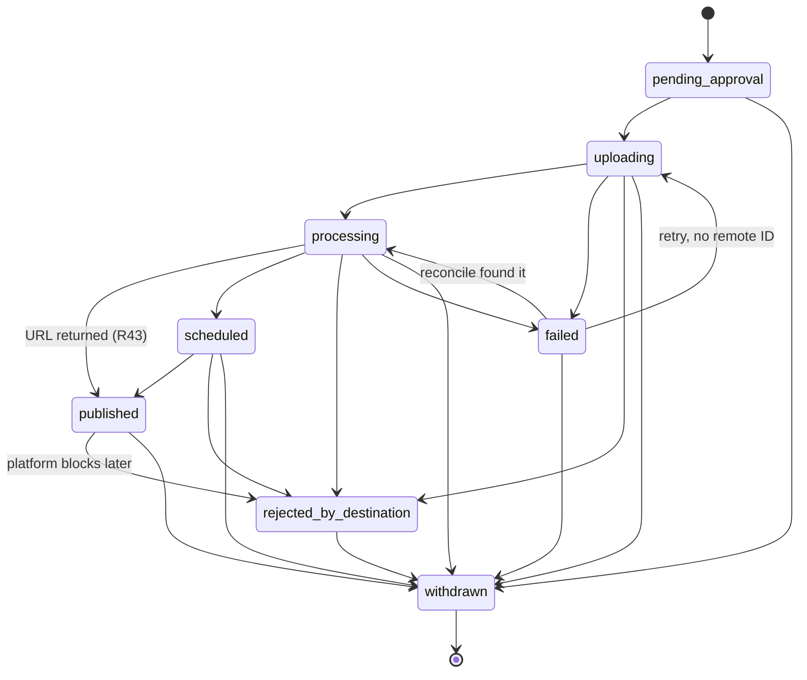

# Component plan: `publishing`

Destinations, the public dataset and the nodes that drive them. Everything here is a **target** until committed. The contract is spec §3.3, §3.4, §7.3, §12.4, §13.2, §15.5, §15.6, §15.8, D7, D11, D17, D18, D24, D25, D26, D30, D35, D37, D45, D52, the master plan (sections 3, 5, 6, 7, 8, 9, 10) and `schemas/public-db/v1.sql`. Decisions taken to fill gaps are in [`docs/decisions/publishing.md`](../decisions/publishing.md) as `I220`–`I239`.

## 1. Scope

In scope:

- `mock` destination with persisted state, failure injection and reconcile (I30).
- `youtube` connector with resumable upload and reconcile, tested only against a local HTTP mock (I12). No real YouTube call anywhere.
- Every catalog-listed node owned by `publishing`: `publish.prepare`, `publish.upload`, `publish.await_processing`, `publish.finalize`, `publish.withdraw`, `publish.refresh`, `catalog.public.sync`, `mediacms.register`.
- `service.Publications` and `connector.PublishingResolver`.
- `internal/publicexport`: `public.db` writer with atomic replace, opaque public IDs, no sensitive segments, no storage keys, no ULIDs.
- `local-file` public catalog connector.
- Skeletons per I11: Vimeo, PeerTube, Instagram Reels, MediaCMS, VideoVortex, Rewind. Each reports `Available: false` and returns `errs.NotImplemented`.

Out of scope:

- The browser OAuth flow for YouTube, a documented gap (I12): the token JSON arrives through `vidyom secret add`.
- `workflows/*.json` (`engine`), approval decisions (`engine`), reading `public.db` (`library`), `wire.go` (`integration`).
- Authorized import from YouTube (`import:` inputs, §3.4): no import connector exists (I11).
- Real destination behavior: quotas, processing times and rejection reasons stay **Validate** (§17.2).

## 2. Package layout

| Path | Package | Holds |
|---|---|---|
| `connectors/publishing/mock` | `mock` | Driver `mock`, JSON state, injection |
| `connectors/publishing/youtube` | `youtube` | Driver `youtube`: resumable upload, status, thumbnails, captions, reconcile |
| `connectors/publishing/vimeo`, `peertube`, `instagram-reels` | `vimeo`, `peertube`, `instagramreels` | Skeletons |
| `connectors/publishing/resolver` | `resolver` | `connector.PublishingResolver` over the registry and tenant configuration |
| `connectors/catalog/public` | `public` | Public catalog driver `local-file` |
| `connectors/catalog/mediacms`, `videovortex`, `rewind` | same | Skeletons |
| `nodes/publishing` | `publishingnodes` | The eight nodes, `service.Publications`, publication state rules, captions rendering |
| `internal/publicexport` | `publicexport` | Selection, sensitive filtering, `public.db` writing, scan guard |
| `internal/publicexport/fakestore` | `fakestore` | In-memory `repo.TenantStore` for this component's tests only, because `core` may not be imported |

`internal/publicexport` links `sqlitedriver`, so it needs cgo. `nodes/publishing` imports it, which keeps these nodes in `vidyomd` only. `vidyom-worker` must never register them (I7, `make check-static`).

## 3. Contract additions

All additive, each as its own `contract:` commit.

| File | Addition | Why |
|---|---|---|
| `internal/contract/connector/publishing.go` | `OutcomeUnknown(err)`, `IsOutcomeUnknown(err)` | A connector cannot import `node`, but the node must know that an effect may have reached the destination (D11) |
| `internal/contract/connector/publishing.go` | Optional interface `EmbedDescriber` | `destinations.embed_url` and `supports_timestamps` differ per platform, and `public.db` must not hard-code them |
| `internal/contract/repo/repo.go` | Optional interface `EmbeddingLister` | `SearchRepo` can store vectors but not read them back, and `public.db` must carry them (D18) |
| `schemas/node-catalog.v1.json` | `publish.finalize` optional `approvalId`, `scheduledAt`; documented `captions` properties | The private-first flow of D37 needs the later approval to reach the node that flips visibility; `scheduled` (D52) needs a date |

## 4. Publication state machine

D52 lists the states. Transitions, enforced by one helper in `nodes/publishing`:



A withdrawn publication stays as history. Publishing again creates a new `PUB-nnn`.

## 5. Nodes

All run in pool `daemon` (I7) and use `node.RequireDaemon`. Every state change commits together with its event (`env.Emit` inside `Store().InTx`). External calls happen outside transactions.

### `publish.prepare` (idempotent)

1. Destination must exist in tenant configuration, and its driver must report `Available`.
2. Asset must not be deleted, and its status must allow publishing (`approved`, `published`, `withdrawn`; `editorial_review` and `ready_for_clipping` only with a private-first flow or a valid approval).
3. Picks the version: parameter or `CurrentVersion`.
4. Picks the file (R4): the version's `working_master` in role `master`. A `published_file` named for this destination is used only when its SHA-256 differs from the master's; when identical it is ignored and `PublishedFile` stays nil. Refuses role `archive`.
5. Approval timing (D37): an `approvalId` must be approved, of kind `publication`, on this asset and version. With none, `allowPrivateUploadBeforeApproval` (destination, else defaults) permits a private upload; otherwise the node fails with `failed_precondition`.
6. In one transaction: returns the record with this idempotency key if it exists; otherwise adopts an active record of the same asset, version and destination; otherwise allocates `PUB-nnn` and emits `publication.created`. Status `pending_approval`.

Output: `publication_id`, `source_uri`, `sha256`, `asset_version`, `already_published`.

### `publish.upload` (reconcilable, paid, abortable)

1. A record with a `remote_id` returns at once. No second upload (§15.5).
2. Re-checks D37, so a workflow cannot skip `publish.prepare`'s gate by passing a publication ID.
3. If an earlier attempt may have run (`uploading`, or attempt above 1), it reconciles first, even though the engine also calls `Reconcile` before a retry.
4. Commits `uploading`.
5. Reads from role `master` only, verifies the recorded SHA-256 first, and uploads as `private`. Visibility only ever opens in `publish.finalize`.
6. Failure classes: `connector.IsOutcomeUnknown` → `node.Unknown`; `unavailable`, `timeout`, `rate_limited` → `node.Transient`; anything else → `node.Permanent` with status `failed`.
7. Success commits `remote_id` and `processing`, or `rejected_by_destination`. Reports usage against the budget (D19).

`Reconcile`: remote ID recorded → done. `connector.Reconcile` finds it → record and done. Finds nothing → not started. Unsupported or erroring → unknown, which moves the job to `needs_attention`.

A per-publication lock stops two jobs uploading the same record at once in this daemon.

### `publish.await_processing` (none)

Polls `GetStatus` with backoff until the destination finishes or `timeoutSeconds` passes. Terminal answers are returned as output (`status`, `ready`, `url`) rather than as errors, so a workflow can route them with `flow.if`, and `rejected_by_destination` stays distinct from `failed` (D52). A timeout is a transient `timeout` error and leaves the record `processing`.

### `publish.finalize` (idempotent)

Order, so a video is never public before its metadata is in place:

1. Refuses `failed`, `rejected_by_destination`, `withdrawn` and a record with no remote ID.
2. Target visibility: parameter, else the record's. Anything other than `private` needs an approved publication approval (D37). Changing an already public video needs a new one (D7).
3. `GetStatus`. Still processing is a transient error.
4. Thumbnail, when the destination supports it: parameter, else the asset's.
5. Captions, only for an approved public target (D30), rendered here from the stored transcript with sensitive segments removed. The daemon never reads scratch (I5), and this way the guarantee does not depend on a workflow having filtered a file.
6. `SetVisibility`, or a scheduled date.
7. Reads status again. Writes `published` only with a remote ID and a URL returned now (R43). No URL means the state stays `processing` and the node retries.
8. In one transaction: record, version immutable (D35), asset status and visibility, audit of the visibility change (D37), `publication.completed` with visibility in the payload. Re-running on a `published` record changes nothing and emits nothing.

### `publish.withdraw` (idempotent)

Selects by `destinations` or `all`, one of them required. `mode` defaults to `private`, and falls back to delete when the destination has no private state. "Not found" at the destination counts as done. Each withdrawn record commits with `publication.withdrawn`. A destination failure does not stop the others and ends in a retryable error. A record already withdrawn goes to `already` with no event, so a repeat is a no-op (§15.8). With nothing active left, the asset moves to `withdrawn` and `private`. No approval is needed (D17).

### `publish.refresh` (none)

By `publicationId` or `assetId`. Re-reads remote state: `scheduled` to `published` with URL, `rejected`, `removed` (recorded as `withdrawn`, and `publication.withdrawn` so the library drops it), visibility changed at the destination. Emits `publication.updated` on change. `service.Publications.Sync` runs the same logic.

### `catalog.public.sync` (idempotent)

Rebuilds through `publicexport`, ships through the configured `connector.PublicCatalog`, emits `public_library.synced`. No public library configured: the export still runs, nothing ships, and the output says so.

### `mediacms.register` (idempotent)

No instance configured: `catalog_sync` stays `none`. Otherwise calls the connector with bounded retries and writes `catalog_sync` as `synced` or `failed`. It **always completes**, because a failed catalog must block nothing (R11, §15.1 item 9). The driver is a skeleton (I11), so a configured MediaCMS records `failed`. Proven with a failing fake catalog connector.

## 6. `mock` destination

Driver `mock`, parameters `stateDir` (required), `processingSeconds`, `reconcile`, and `inject` with counters `fail_upload`, `outcome_unknown`, `outcome_unknown_lost`, `reject`, `fail_remove`. State per destination in `<stateDir>/<tenant>/<destination>.json`, written with temporary file, `fsync` and rename, reloaded on each operation, guarded per path. Counters are persisted, so an injection fires once across restarts.

- `remote_id` derives from the idempotency key; URLs under `https://media.example.internal/watch/` (I30).
- `Upload` with a known key returns the existing video and increments no upload count. `ReadState` exposes the file for E2E evidence.
- `Upload` persists a received offset per key, so a retry after `fail_upload` resumes. It verifies size and SHA-256.
- `URL` is present only when `ready`, so R43 can be exercised with a processing delay.
- Stores captions and thumbnails' hashes per video, so tests can scan what reached the destination.

## 7. `youtube` connector

Hand-written REST over `net/http` and `golang.org/x/oauth2`.

- **Credentials:** `credentialsRef` resolves at first use to token JSON (`client_id`, `client_secret`, `refresh_token`, optional `access_token`, `expiry`). Never logged, never in an error.
- **Upload:** `POST /upload/youtube/v3/videos?uploadType=resumable&part=snippet,status`, then `PUT` chunks with `Content-Range`. On `5xx` or a network error it asks the session where it is (`Content-Range: bytes */N`) and continues. `308` carries the offset; `200/201` carries the video.
- **Classification:** a request carrying the last byte whose response is lost and whose session cannot confirm is `OutcomeUnknown`. Anything earlier is `unavailable`, since a session cannot create a video until it is finalized.
- **Session state:** in memory by default. With `stateDir`, sessions persist AES-256-GCM encrypted under a key derived from the credential, so a restart resumes and reconciles exactly.
- **Reconcile:** session state first (finalized → the video; open → nothing yet; no record with `stateDir` → never reached the destination). Otherwise scans the channel's uploads playlist for the tag `vidyom-<key prefix>`, within a limit; hitting the limit without finding it is an error, never a silent "not there".
- **URLs:** `https://www.youtube.com/watch?v=<id>`, composed only when `videos.list` confirmed the video processed, because the API has no URL field (R43, D45).
- **Other operations:** read-modify-write on `videos.update`, because omitted `status` fields reset. `thumbnails.set`. Captions update an existing track for the language instead of creating a duplicate. `404` on delete is success.
- **Status map:** `uploadStatus` `uploaded` → processing, `processed` → ready or scheduled, `rejected` → rejected with `rejectionReason`, `failed` → failed with `failureReason`, `deleted` or missing → removed.
- **Base URLs** are parameters for tests, HTTPS unless loopback.

Secrets and session URIs must not appear in errors, including `*url.Error` text. A test asserts it.

## 8. `internal/publicexport`

`New(Options{DataDir, Keys})`, then `Export(ctx, Request) (Result, error)`:

1. `Keys.PublicIDKey`; a missing key fails the export (fail closed).
2. Selection: `ListPublic`, then for each record an approved approval and a live asset. Derivatives must be `published`, any kind must have asset visibility `public`.
3. One `videos` row per asset. Version: newest among public publications. Title and description from the newest publication, else the asset.
4. Sensitive marks: the asset version's own, plus the sources' marks mapped through lineage. A lookup failure withholds that video's transcript, chapters and embeddings. Overlapping transcript segments, chapters and vectors are dropped whole.
5. `destinations`: driver name (never the logical destination name), URL, and embed data from `EmbedDescriber`.
6. Embeddings: stored vectors through `repo.EmbeddingLister` when the store has it; otherwise embedded now from the released text through `connector.Embedder`; otherwise none, with `embedding_model` empty, so the site reports lexical mode.
7. `search_fts`: title, description, chapters, released transcript.
8. Writes `<data-dir>/tenants/<tenant>/public.db.tmp-*` from `schemas.PublicDBSchema()`, checkpoints, switches to `journal_mode=DELETE`, runs `integrity_check`, closes, scans the raw bytes for exported assets' ULIDs, friendly IDs and storage keys, `fsync`s, hashes, renames and `fsync`s the directory.

`public_id`: HMAC-SHA256 over the asset ULID, lowercase base32, 26 characters is avoided so it can never look like a ULID. `source_group`: HMAC with a separate label over the root asset. Same tenant key, so IDs are stable across rebuilds and unlinkable between tenants.

## 9. `local-file` public catalog

Driver `local-file`, parameter `directory` (absolute). `Ship` copies to `<directory>/<tenant>/public.db` through a temporary file in the same directory, verifies the SHA-256, `fsync`s, renames, `fsync`s the directory. `Clear` removes the file and treats absence as success. Mode `0644`, the data is public.

## 10. Service and resolver

`publishingnodes.NewService(ServiceDeps)` implements `service.Publications`:

- `Request`, `Withdraw`, `WithdrawOne`: validate, then `Workflows.Run` on `publish-video` and `unpublish-video`, passing `Scope.IdempotencyKey`.
- `List`, `Get`: read the tenant store. Foreign IDs answer `404` because the store is per tenant.
- `Sync`: the refresh logic.
- `Destinations`: tenant configuration joined with the registry's `Info`.

`resolver.New(registry, config.TenantSource, secretsFor)` implements `connector.PublishingResolver`, caching an instance per tenant and destination until its configuration changes.

## 11. Wiring for `integration`

```go
mock.Register(reg); youtube.Register(reg); vimeo.Register(reg); peertube.Register(reg); instagramreels.Register(reg)
public.Register(reg); mediacms.Register(reg); videovortex.Register(reg); rewind.Register(reg)
exporter := publicexport.New(publicexport.Options{DataDir: cfg.DataDir, Keys: derivedKeys})
publishingnodes.Register(nodeReg, publishingnodes.Options{Exporter: exporter, Connectors: reg})
pubs := publishingnodes.NewService(publishingnodes.ServiceDeps{...})
```

`publishingnodes.Register(reg)` with no options still registers every node so validation works, and `catalog.public.sync` and `mediacms.register` then fail with a clear "not wired" error.

## 12. Tests

- **Connectors:** `mock` persistence across instances, every injection, resume, reconcile. `youtube` against an `httptest` server: chunking, `5xx` and connection loss mid-upload, lost final response, session expiry, restart with persisted session, reconcile by session and by tag, token refresh, quota, status mapping, read-modify-write, caption update, no secret or session URI in errors, HTTP refused for non-loopback.
- **Nodes:** full lifecycle on `mock` with the fake store. Descriptors against the catalog, outputs against the catalog's schemas. R43 with a processing delay. R4 with identical and different published files. D37 in both modes, including upload refusing a bypass. D35 immutable after publication only. D52 rejection distinct from failure. D11 reconcile with found, not found and unknown. Idempotent repeats of every node with no duplicate event. Withdrawal twice. Sensitive text absent from captions at the destination. `mediacms.register` with a failing connector.
- **Export:** schema applied, opaque IDs, atomic replace with a failed build leaving the old file, single file with no side files, opens read-only and `immutable=1`. Raw-byte scan for ULIDs, friendly IDs, storage keys, buckets, private original data, sensitive text, unapproved and withdrawn records. Tenant isolation of IDs. Scan guard refuses a poisoned title. Lexical-only and embedder paths.
- **Local file:** ship, replace, clear twice, checksum mismatch leaves the old file.
- **Skeletons:** `Available: false`, reason stated, every method returns `not_implemented`.

`go test -race` on all own paths. Real `core` repositories are exercised by `integration`.

## 13. Order of work

1. This plan. Commit.
2. Review against spec, master plan and contracts; record decisions; commit.
3. Contract additions. Commit each.
4. Skeletons and `local-file`. Commit.
5. `mock`. Commit.
6. `fakestore` and `publicexport` with the scan test. Commit.
7. Publishing nodes and resolver with tests. Commit in steps.
8. `youtube` with its mock server. Commit.
9. `service.Publications`, align with the engine's workflow inputs. Commit.
10. Race tests, `go vet`, `./...`, final report.

## 14. Definition of done (master plan, section 10)

- [ ] `mock` destination with persisted state, failure injection and reconcile
- [ ] `youtube` connector with resumable upload and reconcile tested against an HTTP mock
- [ ] `published` only with URL (R43), published-file deduplication (R4), `allowPrivateUploadBeforeApproval` (D37)
- [ ] `publicexport` producing the schema, atomic replace, opaque public IDs, sensitive segments excluded (D30), test scanning the file for storage keys and ULIDs
- [ ] `local-file` public connector
- [ ] Skeletons with documented gaps per I11
- [ ] Own paths build, `go vet` clean, tests pass with `-race`, decisions recorded, nothing unimplemented presented as working
