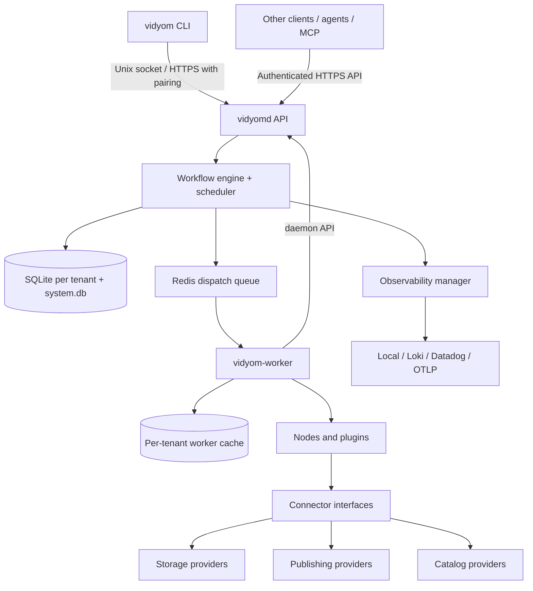

# System architecture

Vidyom follows a **thin client / persistent daemon / worker** design. The architecture was inspired by the Herdr-style experience of connecting to a long-running service, detaching, and later reconnecting. Vidyom manages durable jobs and media artifacts rather than terminal sessions.

## Executables

- `vidyom`: cross-platform lightweight CLI for commands, uploads, status, logs, approvals, and workflow management.
- `vidyomd`: persistent daemon for secure API, graph validation, orchestration, authorization, scheduling, event delivery, state, and audits.
- `vidyom-worker`: isolated processor for FFmpeg, Whisper, AI, storage transfer, and provider API calls. May run on the daemon host initially; distributed workers are a future-compatible design.

## Deployment

**Decided:** Go for `vidyom` (CLI), `vidyomd` (daemon) and the media worker; Python only for the AI worker (faster-whisper, BGE-M3), which talks to the daemon over JSON-RPC. **Proposed:** daemon on Linux and client on macOS/Linux/Windows, with FFmpeg for media processing.

**Decided:** Docker Compose is the supported MVP deployment: the daemon, the workers (with FFmpeg and the Python AI worker packaged) and Redis. The Go binaries can also run natively under systemd, but that is not the primary path. Kubernetes is **Future**.

## State and tenancy

**Decided:** Vidyom is multi-tenant from the MVP. Each tenant (organization) has its own SQLite database file, storage prefix, encrypted secrets, users and roles, budgets and worker cache. A global `system.db` holds tenants, users, roles, device credentials, the plugin registry and wrapped tenant data keys. Databases run in WAL mode and are continuously backed up with Litestream to the archive storage provider. A repository layer keeps PostgreSQL possible later.

**Decided:** Redis (with AOF persistence) is the job dispatch queue and is a required service. The tenant database remains the source of truth for job state, checkpoints and the transactional outbox. On startup, the daemon re-enqueues jobs that are `queued` or `running` in the database but missing from Redis.

**Decided:** Only the daemon opens database files. Workers talk to the daemon through its API or Redis, which also holds for future distributed workers.

**Validate:** sqlite-vec performance at tenant scale, Litestream with GCS, and Redis AOF durability and reconciliation under crash tests.

## Remote access

**Decided:** The remote API is HTTPS (TLS 1.3). An admin generates a one-time pairing code and the CLI exchanges it for a per-device credential that is revocable and rotated. The local Unix socket remains for same-host use. SSH tunneling is available only for host operators, and binding only to a private interface (Tailscale/NetBird) remains supported with the same fail-closed rules.

The daemon operates even when no CLI is connected. Every submitted command producing work returns a `job_id` promptly. Clients may attach to stream logs; disconnecting does not cancel work. Recovery uses persisted checkpoints and idempotency rather than assuming exactly-once execution.

## Trust boundaries

External plugins run in restricted processes or sandboxes. Workflows are untrusted configuration until validated and authorized. Credentials are resolved at execution time, never serialized into job payloads. **Decided:** On the server, secrets live in an encrypted vault inside each tenant database (envelope encryption, one data key per tenant, wrapped by a master key unsealed at boot via TPM/systemd-creds or a cloud KMS); client machines use the OS keyring. A missing or sealed master key makes the daemon fail closed.

Out-of-process plugins talk to the daemon over JSON-RPC 2.0 on stdin/stdout, and remote plugins and services use JSON-RPC over authenticated HTTPS (**Decided**); WASM is **Future**. Public catalog data is explicitly approved and filtered from private assets: per tenant, the daemon exports a read-only `public.db` with only approved public records and their embeddings and ships it to the public site's host, so the daemon is never exposed publicly (**Decided**). The audit log is append-only with hash chaining in each tenant database.
