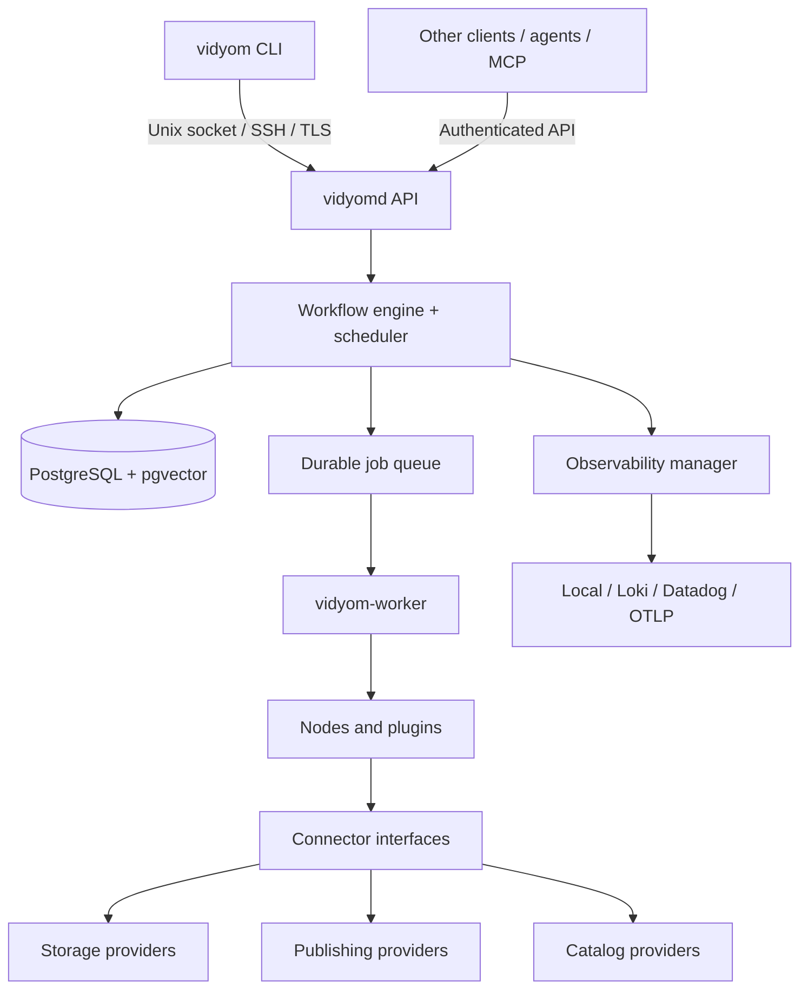

# System architecture

Vidyom follows a **thin client / persistent daemon / worker** design. The architecture was inspired by the Herdr-style experience of connecting to a long-running service, detaching, and later reconnecting. Vidyom manages durable jobs and media artifacts rather than terminal sessions.

## Executables

- `vidyom`: cross-platform lightweight CLI for commands, uploads, status, logs, approvals, and workflow management.
- `vidyomd`: persistent daemon for secure API, graph validation, orchestration, authorization, scheduling, event delivery, state, and audits.
- `vidyom-worker`: isolated processor for FFmpeg, Whisper, AI, storage transfer, and provider API calls. May run on the daemon host initially; distributed workers are a future-compatible design.

## Deployment

Initial proposal: daemon on Linux, client on macOS/Linux/Windows, PostgreSQL for durable state, Go for daemon/client, FFmpeg externally, and Python as an optional faster-whisper worker. These are **proposed implementation choices**, not hard requirements for the platform specification.

The daemon operates even when no CLI is connected. Every submitted command producing work returns a `job_id` promptly. Clients may attach to stream logs; disconnecting does not cancel work. Recovery uses persisted checkpoints and idempotency rather than assuming exactly-once execution.

## Trust boundaries

External plugins run in restricted processes or sandboxes. Workflows are untrusted configuration until validated and authorized. Credentials are resolved at execution time, never serialized into job payloads. Public catalog data is explicitly approved and filtered from private assets.
