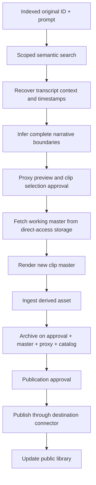

# Workflow B — Create Semantic Clip

The input is an **already indexed original asset ID**, plus a natural-language description. The workflow runs at any later date and does not require rerunning ingestion or retrieving archival backups.

Examples:

- “The story about the 90-year-old woman who felt no remorse.”
- “The case of the friend who never received a hug.”
- “The explanation of Ujjayi breathing.”

## Locating a complete story

Use transcript chunks and embeddings **scoped to the selected asset**. Recover surrounding transcript context so the model can identify introduction, narrative development, conclusion and natural word/sentence boundaries. Preserve correct video offsets if voice activity detection removes silence from an audio processing copy. If the story is told in multiple distant passages, distinguish a multi-segment montage from a continuous excerpt.

If a request produces intervals that substantially overlap an existing clip of the same source, Vidyom warns and shows the existing clip before proceeding; it does not block.

Story and chapter detection uses an LLM through the single OpenAI-compatible driver. Each configured endpoint is classified as `local` or `external`, and the default `aiProcessing: local_only` allows only a local endpoint (for example Ollama or vLLM on the host). When no local endpoint is available, story detection is unavailable for that collection and clip selection falls back to manual review.

A scoring step reports candidate segments, time ranges, the supporting transcript excerpt and a confidence score. When confidence is low or there are several candidates, the clip is marked ambiguous and the alternatives are shown side by side. Vidyom does not present an uncertain segment as found exactly; the user can review and adjust it.

## Rendering

Before render, verify source state `ready_for_clipping` and working master availability. Fetch the required master or byte ranges from logical storage `master` to a local worker cache; **never fall back to `archive`**. Render with FFmpeg from the production master, not from the heavily compressed preview proxy. Preserve source time ranges, codec settings, transformation parameters and checksum.

## Approval and retention

Approval has two levels. An `editor` approves the clip selection (`approval.request` of kind `clip_selection`); a `publisher` or `admin` approves publication later (kind `publication`, see [publication](./publication.md)). A workflow can tighten this rule through `approvers`, never loosen it. The editor's selection approval is always required, and no policy can skip it.

The master of a clip is archived when its selection is approved. Rejected or never-approved renders stay only in the `master` role and expire after 30 days (configurable per tenant).

## Clips of clips

A derivative that has reached `ready_for_clipping` can be the source of a new clip. Intervals are converted to the root original's timeline and, when the edit is continuous, rendered from the root original's master. The lineage records the full chain.

## A new original for every clip

Each accepted clip receives its own immutable asset ID (`CLIP-*`), independently managed master file, archival backup, proxy, metadata, transcript or derived transcript, catalog entry, and editorial state. Parent IDs and ordered source segments are preserved. The clip passes through `ingest-derived.json` and then `publish-video.json` as reusable subworkflows. Existing transcript segments may be reused when alignment remains valid; modified spoken audio is retranscribed or validated.

## Publish safely

The default is **human approval before publication**, and before the upload (see [publication](./publication.md)). Editorial steps may create subtitles, title, description, thumbnail and platform variants. Clips publish to YouTube, Vimeo, PeerTube and Instagram Reels through provider connectors. The public library only receives approved public records and never private master URLs or unreviewed transcripts.

## Repeatability

Running the clip workflow months later against the same original uses its permanent working master and previously generated index. Two clips are two independent assets; re-editing a clip creates a new version without losing lineage or publication history. Idempotency keys prevent duplicate remote uploads on retries.
