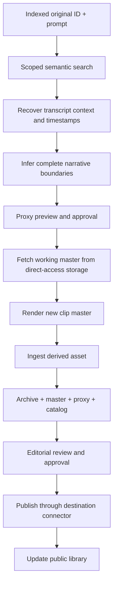

# Workflow B — Create Semantic Clip

**Decided:** The input is an **already indexed original asset ID**, plus a natural-language description. The workflow runs at any later date and must not require rerunning ingestion or retrieving archival backups.

Examples:

- “The story about the 90-year-old woman who felt no remorse.”
- “The case of the friend who never received a hug.”
- “The explanation of Ujjayi breathing.”

## Locating a complete story

Use transcript chunks and embeddings **scoped to the selected asset**. Recover surrounding transcript context so the model can identify introduction, narrative development, conclusion and natural word/sentence boundaries. Preserve correct video offsets if voice activity detection removes silence from an audio processing copy. If the story is told in multiple distant passages, distinguish a multi-segment montage from a continuous excerpt.

A scoring step should report candidate segments, time ranges, supporting transcript evidence and confidence. Avoid pretending an uncertain segment was found exactly; allow user review and adjustment.

## Rendering

Before render, verify source state `ready_for_clipping` and working master availability. Fetch the required master or byte ranges from logical storage `master` to a local worker cache; **never fall back to `archive`**. Render with FFmpeg from the production master, not from the heavily compressed preview proxy. Preserve source time ranges, codec settings, transformation parameters and checksum.

## A new original for every clip

Each accepted clip receives its own immutable asset ID (`CLIP-*`), independently managed master file, archival backup, proxy, metadata, transcript or derived transcript, catalog entry, and editorial state. Preserve parent IDs and ordered source segments. The clip passes through `ingest-derived.json` and then `publish-video.json` as reusable subworkflows. Existing transcript segments may be reused when alignment remains valid; modified spoken audio must be retranscribed or validated.

## Publish safely

The default is **human approval before publication**. Editorial steps may create subtitles, title, description, thumbnail and platform variants. Publish to YouTube first, with Vimeo and others supported via provider connectors. The public library only receives approved public records and never private master URLs or unreviewed transcripts.

## Repeatability

Running the clip workflow months later against the same original must use its permanent working master and previously generated index. Two clips are two independent assets; re-editing a clip creates a new version without losing lineage or publication history. Use idempotency keys to prevent duplicate remote uploads on retries.
