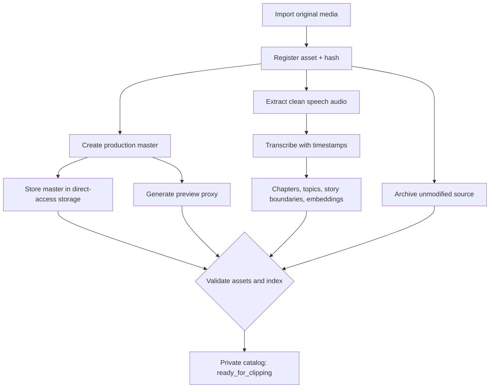

# Workflow A — Ingest Original

**Decided:** Ingestion runs first and is independent of clip creation. The input is any original recording (yoga class, course, meeting, lecture, interview, etc.). After processing, the original is permanently available for future semantic clipping.

## Detailed stages

1. **Import:** accept a local file, resumable upload, or an authorized imported copy from an existing platform. Calculate SHA-256; create stable `ORI-*` ID and metadata.
2. **Archive:** save an untouched copy to logical storage role `archive`; verify checksum and record receipt. The initial connector is Google Cloud Storage Archive.
3. **Master:** generate high-quality working MP4 (suggested 1080p H.264 or HEVC depending on source and platform); store it permanently under role `master` (initially GCS Standard).
4. **Proxy:** produce smaller playback/preview MP4 (suggested 720p H.264) stored under role `proxy`.
5. **Audio:** derive mono speech audio directly from the raw original, avoiding double lossy conversion. Suggest Opus 16 kHz, 24–32 kbps where accepted by transcription provider.
6. **AI:** transcribe with timestamps; extract chapters, narratives, topics, summaries and embeddings. Map timecodes to original media timeline.
7. **Catalog:** register with MediaCMS, update VideoVortex or the text index, store canonical metadata; verify accessible master/index, then mark `ready_for_clipping`.

## Storage policy

- `archive`: long-term protection, never a normal working source.
- `master`: durable, frequent-access, production-quality video. **Not a temporary cache.**
- `proxy`: playable reduced video; may be regenerated if the working master remains accessible.
- `transcripts`, `chapters`, `metadata`, `embeddings`: persistent and portable.
- Transcription-only audio and transient render files may be deleted after integrity verification and successful processing.

## YouTube import

If Vidyom itself published the media, **retain the exact uploaded source** in operational storage, so future edits never need to download from YouTube. If an owned video exists only on YouTube, first obtain an authorized local copy and cache/persist it as an imported asset before indexing. Do not assume the YouTube Data API provides a general video-file download endpoint or that the download has the same quality as the original.

## Acceptance criteria

A new original can be ingested end to end, searchable by keyword and semantic prompt, and clipped without archive access. Any failure in backup, transcription, index, or storage verification leaves the asset in a visible incomplete state rather than claiming readiness.
